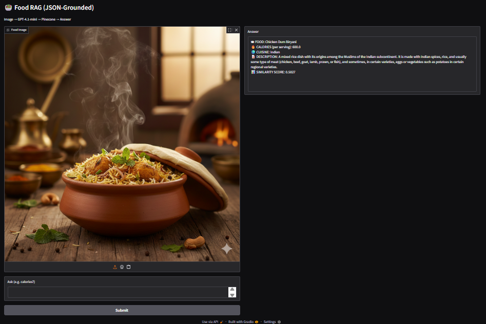
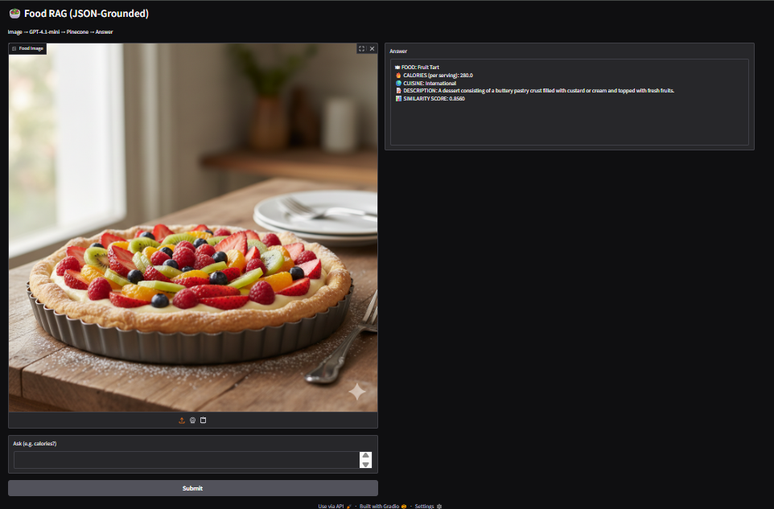
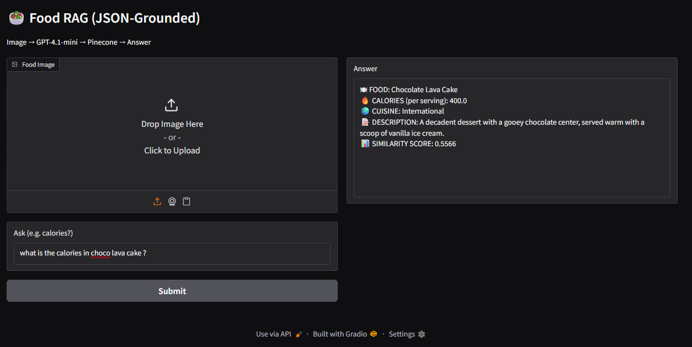
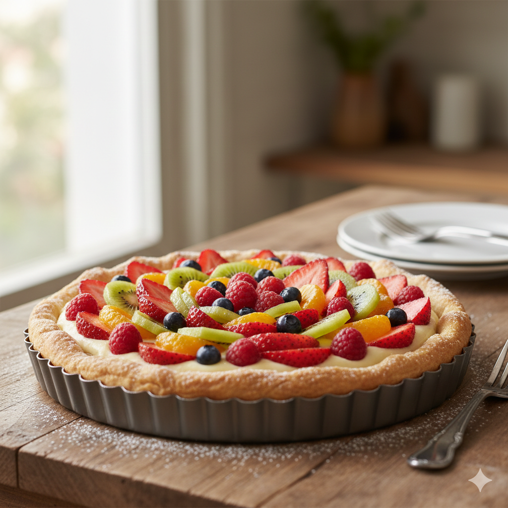

# 🍽️ DETERMINISTIC MULTIMODAL FOOD INTELLIGENCE SYSTEM  
**A Deterministic, JSON-Grounded, Image-First Food RAG System**

---

## 📖 Overview

The **Deterministic Multimodal Food Intelligence System** is an applied AI system that performs **food identification and nutrition intelligence** using a **strictly deterministic, embedding-driven Retrieval-Augmented Generation (RAG) pipeline**.

This system is **not** a chatbot, **not** a probabilistic vision demo, and **not** a generative nutrition estimator.

Every response is:
- grounded **only** in a static JSON dataset
- retrieved through **semantic embeddings**
- resolved using **top-1 Pinecone matching**
- fully auditable and repeatable

---

## 🧠 What This System Does

The system enables a user to:

1. Upload a food image
2. Identify the food using a vision model
3. Convert the identified food into an embedding
4. Retrieve nutrition data from a JSON-backed vector index
5. Optionally refine results using a text query (e.g. calories)

All execution paths are demonstrated below using **real UI outputs**.

---

## 🛡️ Design Principles

### ✅ Deterministic by Construction
- Single embedding model
- Fixed 384-dimension vector space
- `top_k = 1` enforced
- No reranking
- No fallback answers

### ✅ JSON-Faithful
- All nutrition data comes **only** from `FoodDataSet.json`
- No external APIs
- No inferred or estimated values

---

## 🚀 Key Capabilities

- Image-based food identification
- Text-based nutrition queries
- Image + text combined reasoning
- Deterministic semantic retrieval
- Pinecone-backed vector search
- Fully transparent similarity scoring

---

## 🧠 System Architecture

Image
↓
Vision Model (GPT-4.1-mini)
↓
Food Name
↓
SentenceTransformer Embedding (384-dim)
↓
Pinecone Vector Index (top_k = 1)
↓
FoodDataSet.json Metadata
↓
Final Answer


---

## 🧬 Embeddings (Executable, Not Theoretical)

- **Model:** sentence-transformers/all-MiniLM-L6-v2
- **Embedding Dimension:** 384 (LOCKED)
- **Normalization:** Enabled
- **Vector Store:** Pinecone
- **Query Strategy:** Exact semantic match, top-1 only

This embedding space is **global, invariant, and deterministic**.

---

## 🛠 Tech Stack

- **Language:** Python  
- **UI:** Gradio  
- **Vision Model:** GPT-4.1-mini  
- **Embeddings:** SentenceTransformers (384-dim)  
- **Vector DB:** Pinecone  
- **Data Source:** Static JSON  
- **Output:** Deterministic text response  

---

## 📂 Project Structure

Deterministic_Multimodal_Food_Intelligence_System/
│── deterministic_multimodal_food_intelligence_system.py
│── test_1_only_image.png
│── test_2_only_image.png
│── test_3_only_text_based.png
│── test_image_1.png
│── test_image_2.png
│── README.md
│── LICENSE


---

## 🧪 Step-by-Step System Demonstration

### 1️⃣ Image-Only Input → Deterministic Answer



---

### 2️⃣ Image-Only Input (Different Cuisine)



---

### 3️⃣ Text-Only Query (No Image)



---

### 4️⃣ Image + Text Combined Query


---

### 5️⃣ Final Deterministic Output



---

## ⚠️ Limitations & Disclosure

- No probabilistic reasoning
- No hallucinated answers
- No multi-result ranking
- Dataset-bound knowledge only
- Unknown foods return no result

All screenshots represent **actual system executions**.

---

## ▶️ Usage

```bash
pip install gradio sentence-transformers pinecone-client openai pillow
python deterministic_multimodal_food_intelligence_system.py
👨‍💻 Author
Shubham Singh

📜 License
MIT License

