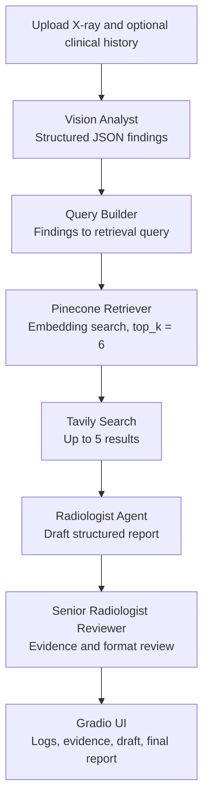
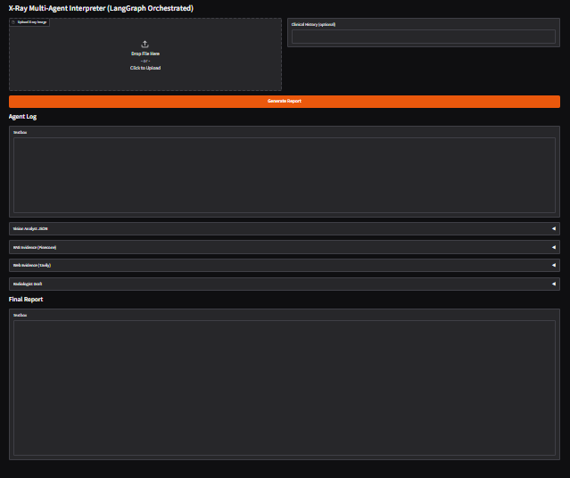
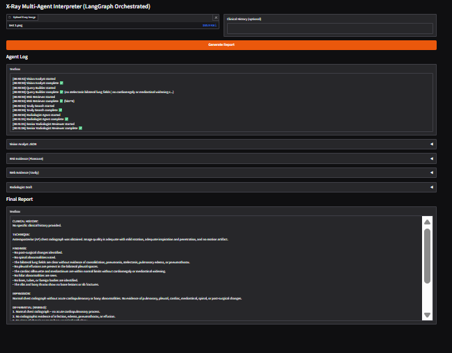
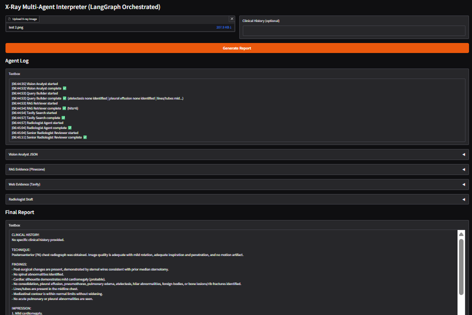
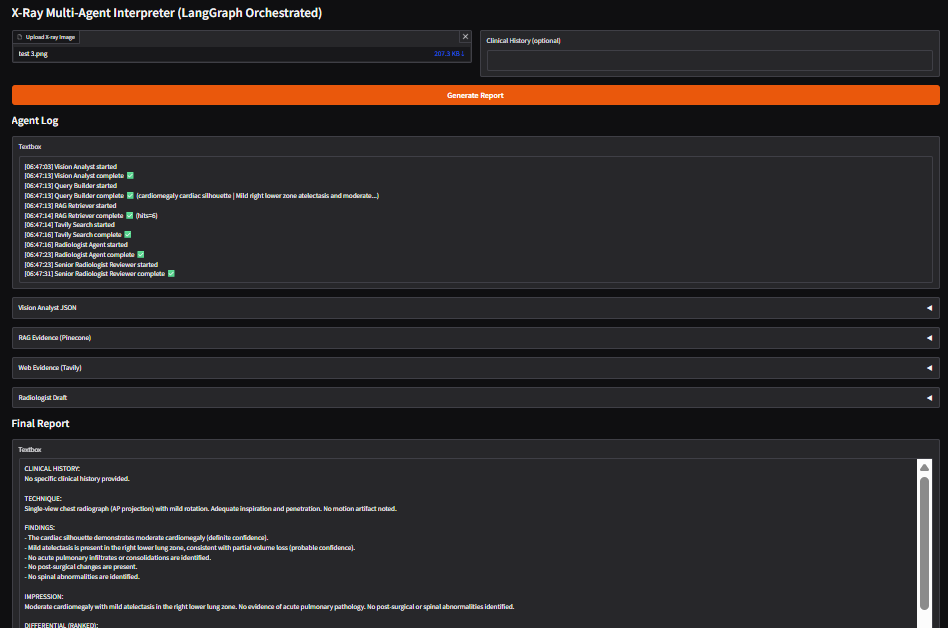

# X-Ray Agentic Radiologist

**A LangGraph-orchestrated, evidence-grounded radiology report generation research prototype using vision analysis, Pinecone retrieval, web search, and a report-review agent.**

[](#license)  

> **Clinical safety notice:** This project is a research and portfolio prototype, not a medical device. Its output is not a diagnosis and must not be used to make clinical decisions. A qualified medical professional must independently interpret medical images and verify any generated content.

## Overview

X-Ray Agentic Radiologist is a multi-stage workflow for producing a structured report from an uploaded X-ray image and optional clinical history. LangGraph coordinates the stages, and the Gradio interface exposes the execution log, intermediate artifacts, retrieved evidence, draft report, and reviewed report.

Unlike a single-call vision demo, the workflow separates visual analysis, retrieval-query construction, evidence retrieval, report drafting, and report review into explicit graph nodes. The repository demonstrates this workflow on three frontal chest X-ray examples from the OpenI (NLM) Indiana University Chest X-rays collection.

## What It Does

- Accepts a `.png`, `.jpg`, or `.jpeg` image and optional clinical history.
- Produces structured vision findings as JSON, including image-quality descriptors, findings, post-surgical changes, spinal abnormalities, red flags, and a short summary.
- Builds a retrieval query from the extracted findings.
- Retrieves up to six matching chunks from a Pinecone index.
- Queries Tavily for up to five external search results; the workflow continues with an empty result list when Tavily returns a non-200 response.
- Drafts a report with fixed sections: clinical history, technique, findings, impression, ranked differential, recommendations, and limitations.
- Sends the draft and evidence to a dedicated reviewer agent instructed to check support, remove hallucinations, and preserve the report structure.
- Displays the agent log and intermediate outputs in the Gradio UI for review.

## Design Principles

### Explicit workflow, not a single prompt

Each stage is a separate LangGraph node with identifiable input and output artifacts. This makes the workflow easier to inspect and debug; it does not guarantee that the generated findings are correct.

### Evidence-assisted generation

The report agent receives the vision JSON, retrieved Pinecone chunks, and Tavily results. The prompts instruct the agent to prioritize visual findings and use retrieved evidence as support. Retrieved material and web results may still be incomplete, irrelevant, or incorrect and must be checked.

### Review stage included in the graph

A Senior Radiologist Reviewer node reviews the draft against the available vision JSON and retrieved evidence. This is a model-based review step—not a validated clinical safeguard, independent medical review, or formal guarantee that hallucinations have been eliminated.

### Visible intermediate artifacts

The interface exposes agent logs, vision JSON, RAG hits, web evidence, the draft, and the final report. This supports inspection of individual workflow stages rather than hiding all intermediate processing.

## Architecture



### Workflow components

| Component | Responsibility | Implementation details |
|---|---|---|
| Vision Analyst | Extracts image findings and study descriptors | OpenAI vision-capable chat completion; JSON response format |
| Query Builder | Converts vision findings into a retrieval query | Includes findings, post-surgical changes, spinal abnormalities, and summary fallback |
| Pinecone Retriever | Retrieves internal knowledge chunks | Index `xray-rag-1024`; `top_k=6`; requests metadata |
| Web Evidence | Retrieves external search results | Tavily Search API; maximum five results |
| Radiologist Agent | Drafts the structured report | Receives clinical history, vision JSON, RAG hits, and web results |
| Senior Radiologist Reviewer | Reviews and revises the draft | Receives the same evidence and the draft report |
| Gradio UI | Presents trace and outputs | Image upload, optional history, agent log, accordions for artifacts, final report field |

## Embeddings and Retrieval Configuration

| Setting | Configured value |
|---|---|
| Vector database | Pinecone |
| Index name | `xray-rag-1024` |
| Embedding model | `BAAI/bge-large-en-v1.5` |
| Embedding dimension | `1024` |
| Embedding normalization | Enabled (`normalize_embeddings=True`) |
| Retrieval depth | `top_k=6` |
| Retrieved metadata | `chunk_id`, `text`, and match score |

The code checks that the embedding model returns 1,024 dimensions at startup. The project directory does not include a Pinecone index-provisioning or document-ingestion pipeline; a compatible index and populated records must already be available.

## Technology Stack

- **Language:** Python
- **UI:** Gradio
- **Workflow orchestration:** LangGraph
- **LLM API:** OpenAI
- **Vector database:** Pinecone
- **Embedding model:** SentenceTransformers with `BAAI/bge-large-en-v1.5`
- **External search:** Tavily Search API
- **Structured state:** Python `TypedDict` and JSON

## Repository Contents

```text
agentic-radiologist/
├── README.md
├── agentic_radiologist.py
├── data.docx
├── interface.png
├── output_1.docx
├── output_2.docx
├── output_3.docx
├── test_1.png
├── test_2.png
└── test_3.png
```

`data.docx` is included in the repository, but the checked-in application script does not read it at runtime. The current folder also does not include an automated ingestion script for preparing the Pinecone index.

## Interface

The following screenshot is included with the repository.



## Demonstration Dataset

The three example images are identified in the project as coming from the **OpenI (NLM) Indiana University Chest X-rays Collection**. The reference reports below are the study-level context recorded in the project's original README; they should not be treated as a guaranteed one-to-one gold standard for a system that receives only a single image.

> **View limitation:** The original OpenI report may be associated with a multi-view study, while this workflow is demonstrated with one uploaded image. Differences between the generated report and a reference report therefore need careful interpretation.

### Test 1



**Reference-report summary recorded by the project:** clear lungs, normal heart, and suture material at the left apex suggesting prior lung surgery.

[View the OpenI record](https://openi.nlm.nih.gov/detailedresult?img=CXR452_IM-2083-1001&query=Indiana%20U.%20Chest%20X-rays,%20Pneumonia&it=xg&uniq=1&req=4&npos=1)

### Test 2



**Reference-report summary recorded by the project:** sternotomy changes, no focal infiltrates, no pleural effusion, and an impression of no acute disease.

[View the OpenI record](https://openi.nlm.nih.gov/detailedresult?img=CXR125_IM-0169-1001&query=Indiana%20U.%20Chest%20X-rays,%20Effusion&it=xg&uniq=1&req=4&npos=2)

### Test 3



**Reference-report summary recorded by the project:** thoracolumbar rotatory scoliosis, atherosclerotic aorta, hypoinflated but clear lungs, and an impression of hypoinflation without acute disease.

[View the OpenI record](https://openi.nlm.nih.gov/detailedresult?img=CXR484_IM-2108-1001&query=Indiana%20U.%20Chest%20X-rays&it=xg&coll=cxr&uniq=1&req=4&npos=7)

## Example Report Artifacts

The repository includes three `.docx` files as example report artifacts:

- [Output 1](./output_1.docx)
- [Output 2](./output_2.docx)
- [Output 3](./output_3.docx)

These files are examples, not a substitute for expert evaluation or a repeatable clinical benchmark.

## Model-Comparison Notes and Interpretation

The original project description records qualitative comparisons across three sample images involving `gpt-4.1-mini` and `gpt-5-mini`. It describes examples in which an earlier `gpt-4.1-mini` run reported unsupported lines/tubes in Test 2 and overconfident cardiomegaly in Test 1, while recorded `gpt-5-mini` outputs were described as more cautious.

**Important configuration detail:** the checked-in script currently sets both `MODEL_VISION` and `MODEL_AGENTS` to `gpt-4.1-mini`. It does not automatically run a two-model comparison or calculate clinical accuracy metrics. The observations above are qualitative reports from a small set of examples, not a controlled clinical evaluation and not evidence that either model is clinically safe.

## Setup and Usage

### Execution environment

The checked-in `agentic_radiologist.py` is exported from Google Colab. It contains notebook-specific syntax (`!pip`) and imports `google.colab.userdata` to read secrets. **It is not directly executable as a normal local Python script without adaptation.**

### Run in Google Colab

1. Create a Google Colab notebook.
2. Add the following secrets in Colab's **Secrets** panel and grant the notebook access to them:
   - `OPENAI_API_KEY`
   - `PINECONE_API_KEY`
   - `TAVILY_API_KEY`
3. Copy the code into a notebook cell, preserving the initial `!pip` installation command, or convert the installation command into a separate notebook cell.
4. Confirm that the Pinecone index `xray-rag-1024` exists, has 1,024-dimensional vectors, and contains records with the `chunk_id` and `text` metadata expected by the script.
5. Run the cell. After model, Pinecone, and embedding initialization completes, use the Gradio interface to upload an image and optionally enter clinical history.

The source installs these dependencies in its notebook setup cell:

```bash
!pip -q install -U gradio openai pinecone sentence-transformers requests langgraph langchain langchain-openai pydantic
```

### Local execution

To run outside Colab, first move dependency installation out of the Python source and replace `google.colab.userdata.get(...)` with environment-variable loading (for example, `os.environ.get(...)`). Set the three API keys in your local environment before launching the app. These local-runtime changes are not included in the checked-in script.

### Runtime behavior

The Gradio app provides an image upload field, optional clinical history, a **Generate Report** button, an agent-log panel, expandable intermediate outputs, and a final-report field. The current script calls `demo.launch(debug=True)` and does not implement a dedicated report-download control in the interface; the `.docx` artifacts listed above are files already included in the repository.

## Operational Requirements and Limitations

- Valid OpenAI, Pinecone, and Tavily API credentials are required.
- Pinecone access and a populated index named `xray-rag-1024` are required before inference can complete.
- The script validates embedding dimension, but does not provision the index or validate the clinical quality of its contents.
- Tavily non-200 responses are handled by continuing without web results; other network or API exceptions may still interrupt execution.
- The reviewer is another LLM call and can miss errors or introduce new ones.
- There is no automated evaluation suite in this project folder that reports sensitivity, specificity, calibration, hallucination rate, or clinician agreement.
- The included three-image demonstration is too small to establish generalization or clinical performance.
- Treat all generated findings, recommendations, confidence values, and differentials as unverified model output.
- Avoid uploading identifiable patient information to third-party APIs unless you have the required legal basis, consent, and organizational controls.
- Do not expose a development Gradio instance or API credentials publicly.

## References

- [OpenI — Indiana University Chest X-rays Collection](https://openi.nlm.nih.gov/)
- [LangGraph documentation](https://langchain-ai.github.io/langgraph/)
- [Gradio documentation](https://www.gradio.app/docs)
- [Pinecone documentation](https://docs.pinecone.io/)
- [SentenceTransformers documentation](https://www.sbert.net/)
- [Tavily Search API documentation](https://docs.tavily.com/)
- [OpenAI API documentation](https://platform.openai.com/docs/)

## Author

**Shubham Kumar Singh**

## License

The original project README declares the project to be licensed under the MIT License. The repository directory listing inspected for this update did not include a standalone `LICENSE` file; add one to the repository if you intend the license declaration to be explicit and complete.
