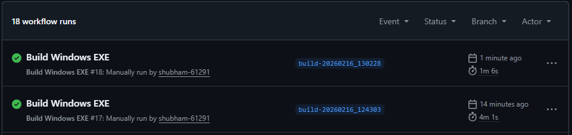
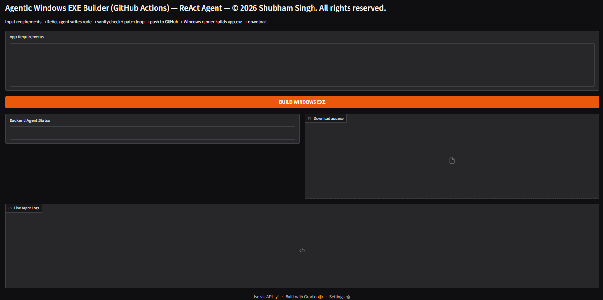
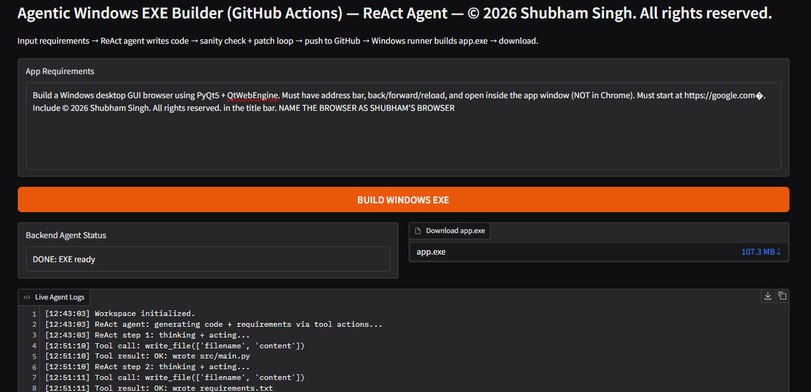
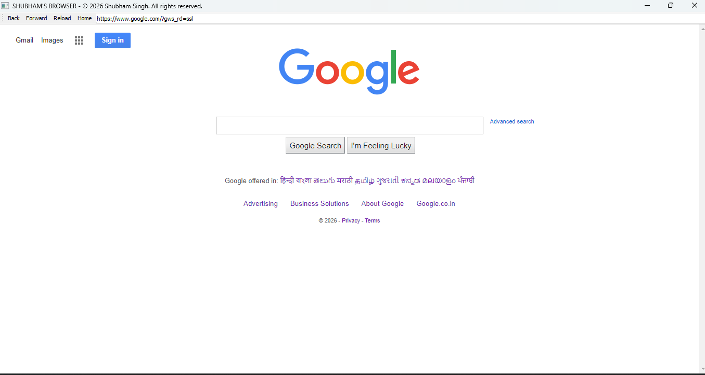
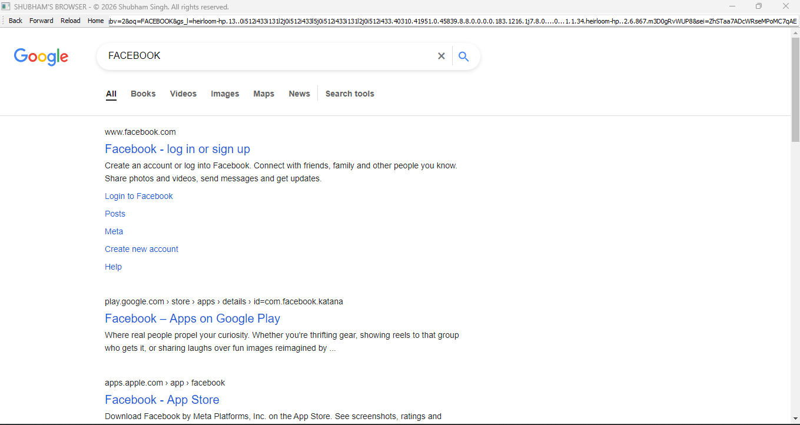
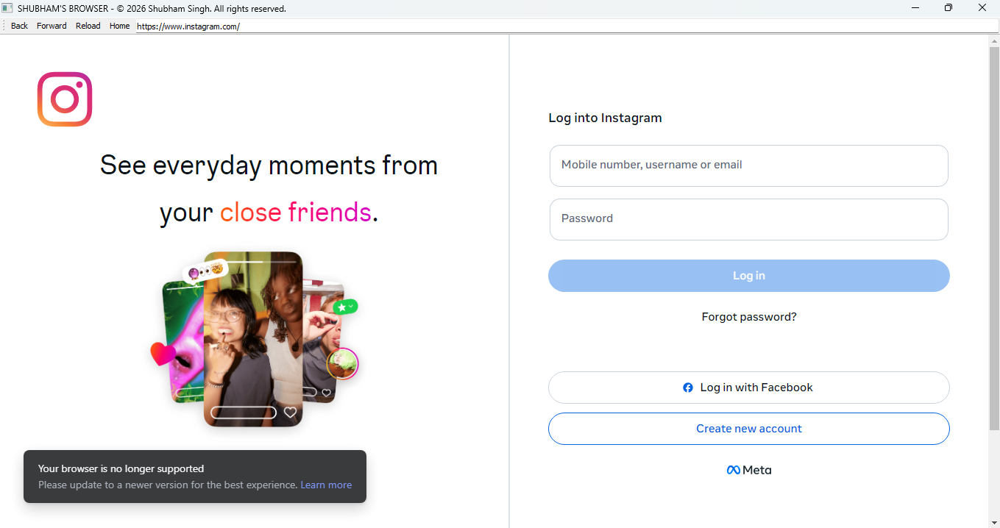
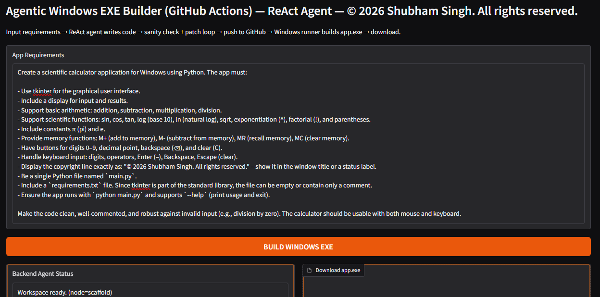
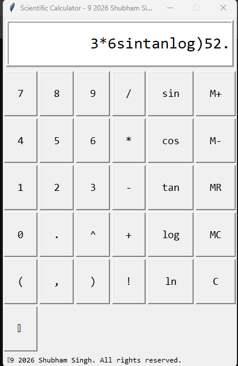

# 🪟 Agentic Windows EXE Builder (GitHub Actions)  
**A Deterministic ReAct Coding Agent that Generates Python Apps and Ships a Real Windows `.exe` via GitHub Actions**

---

## 📖 Overview

The **Agentic Windows EXE Builder** is an applied AI system that converts **plain-English application requirements** into a **real Windows executable (`app.exe`)** using a strict, deterministic agent workflow.

This system is **not** a chatbot, **not** a code snippet generator, and **not** a “toy” Gradio demo.

It is a **full agentic build pipeline** where an agent:

- writes application source code (`src/main.py`)
- writes dependency spec (`requirements.txt`)
- runs a deterministic sanity check (`python -m py_compile`)
- auto-patches the code if compilation fails
- pushes to a unique Git branch
- triggers GitHub Actions Windows runner
- downloads the build artifact
- extracts the final `app.exe` and exposes it in the UI

All screenshots below are from **real system executions**.

---

## 🧠 What This System Does

The system enables a user to:

1. Enter an app requirement in plain English  
2. Let the ReAct agent generate:
   - `src/main.py`
   - `requirements.txt`
3. Run a compile sanity check locally in Colab  
4. If the build fails, trigger a patch loop automatically  
5. Push the generated code to GitHub in a unique branch  
6. Trigger GitHub Actions to build a Windows `.exe`  
7. Download the final `app.exe` directly from the UI  

---

## 🛡️ Design Principles

### ✅ Deterministic by Construction
- Model temperature is locked to `0`
- Strict maximum ReAct steps enforced
- Strict maximum patch rounds enforced
- Sanity check must pass before GitHub build starts

### ✅ Tool-Grounded Execution
The agent is not allowed to write files directly.

It can only use:
- `write_file()`
- `read_file()`

This ensures all code artifacts are produced via **auditable tool actions**.

### ✅ Real Windows Build (Not Simulated)
The `.exe` is not built in Colab.

Instead, it is built using:
- GitHub Actions Windows runner
- artifact packaging + download
- deterministic extraction into `/release/app.exe`

---

## 🚀 Key Capabilities

- ReAct agent writes complete runnable Python apps
- Automatic dependency generation (`requirements.txt`)
- Deterministic sanity check:
  - `python -m py_compile src/main.py`
- Auto-debug patch loop if compilation fails
- Unique Git branch creation per run
- GitHub Actions workflow dispatch
- Artifact download + `.exe` extraction
- Gradio UI for full build orchestration
- Downloadable final executable

---

## 🧠 System Architecture
```
User App Requirements
↓
ReAct Codegen Agent (GPT-4.1-mini, temp=0)
↓
Tool Calls:

write_file(src/main.py)

write_file(requirements.txt)
↓
Sanity Check:
python -m py_compile src/main.py
↓
If Failed:
Patch ReAct Agent (minimal changes)
↓
Push to GitHub (unique build branch)
↓
Trigger GitHub Actions Windows Runner
↓
Build Artifact: windows-exe.zip
↓
Extract app.exe
↓
Download from UI

```
---

## 🛠 Tech Stack

- **Language:** Python  
- **Agent Framework:** LangGraph  
- **LLM:** GPT-4.1-mini  
- **UI:** Gradio  
- **Build System:** GitHub Actions (Windows runner)  
- **Packaging:** Artifact zip download + deterministic extraction  
- **Execution Environment:** Google Colab  

---

## 📂 Project Structure
```
agentic_software_development/
│── agentic_windows_exe_builder.py
│── README.md
│
│── GIT_WORKFLOWS.png
│── interface.png
│
│── TEST_1.png
│── TEST_1_AGENT_LOG.txt
│── TEST_1_OUTPUT.png
│── TEST_1_OUTPUT_2.png
│── TEST_1_OUTPUT_3.png
│
│── TEST_2.png
│── TEST_2_AGENT_LOG.txt
│── TEST_2_OUTPUT.png
```

---

## 🧪 Step-by-Step System Demonstration

## 1️⃣ GitHub Actions Workflow Runs (Real Windows Build Proof)

This screenshot shows multiple successful GitHub Actions workflow executions.



---

## 2️⃣ Gradio UI (Initial State)

The system UI exposes:
- App requirements textbox
- Build button
- Status display
- Live agent logs
- Final `.exe` download widget



---

## 3️⃣ TEST 1 — App Requirement: PyQt Browser

This test prompts the agent to build a full Windows GUI browser using:
- PyQt5
- QtWebEngine
- address bar
- back/forward/reload controls
- in-app navigation (not Chrome)



---

## 4️⃣ TEST 1 — Agent Logs (Codegen + Patch + Build)

This run demonstrates:
- deterministic tool calls (`write_file`)
- sanity check failure due to invalid syntax
- patch loop applied
- successful GitHub Actions build
- artifact download and extraction



---

## 5️⃣ TEST 1 — Browser Output (Google Page Loaded)

The generated Windows executable successfully launches a browser window and loads Google inside the app.



---

## 6️⃣ TEST 1 — Browser Output (Search Result Navigation)

The browser supports search and navigation inside the embedded QtWebEngine window.



---

## 7️⃣ TEST 2 — App Requirement: Scientific Calculator (Tkinter)

This test prompts the agent to build a full scientific calculator including:

- arithmetic operations
- scientific functions (sin/cos/tan/log/ln/sqrt)
- constants π and e
- memory functions (M+, M-, MR, MC)
- keyboard support
- visible copyright line



---

## 8️⃣ TEST 2 — Scientific Calculator Output

The generated Windows `.exe` successfully launches a working scientific calculator GUI.



---

## 🧾 Example Agent Logs (Verifiable Runs)

### ✅ TEST 1 Agent Log

Saved as:

- `TEST_1_AGENT_LOG.txt`

This log shows:
- deterministic ReAct tool calls
- sanity check failure due to null bytes
- patch loop applied
- successful GitHub Actions build

---

### ✅ TEST 2 Agent Log

Saved as:

- `TEST_2_AGENT_LOG.txt`

This log shows:
- deterministic ReAct tool calls
- sanity check failure due to a syntax error
- patch loop applied
- successful GitHub Actions build

---

## ⚠️ Limitations & Disclosure

- The system relies on GitHub Actions Windows runners for builds
- Builds require a valid GitHub token stored in Colab Secrets
- The agent may generate invalid code in the first attempt
  - patch loop corrects most compilation errors
- The system currently performs compilation sanity checks
  - it does not run full GUI integration tests

All screenshots represent **actual system executions**.

---

## ▶️ Usage

### 1) Install Dependencies

```bash
pip install -U langchain langchain-openai pydantic langgraph gradio requests
2) Run
python agentic_windows_exe_builder.py

```
🔐 Required Secrets (Colab)
This system expects the following secrets inside Colab:

OPENAI_API_KEY

GITHUB_TOKEN

These secrets are never committed to GitHub.

👨‍💻 Author

Shubham Singh

📜 License

MIT License


