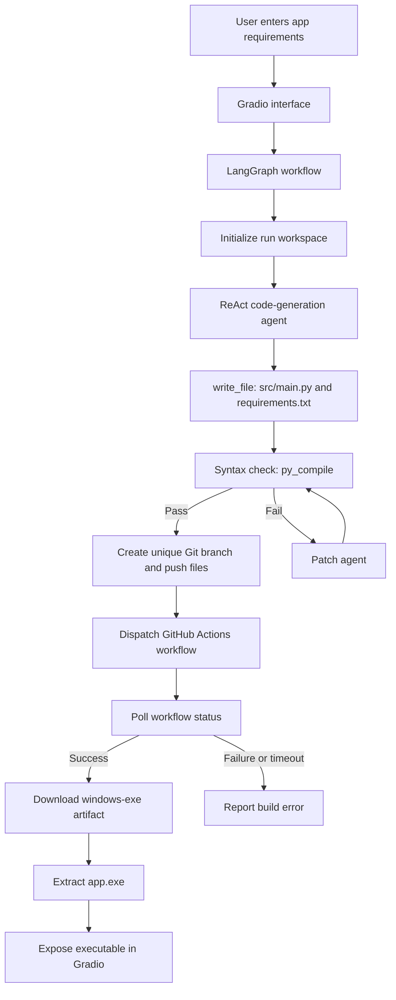

# Agentic Windows EXE Builder

**A LangGraph-orchestrated ReAct coding agent that turns plain-English requirements into Python applications and retrieves Windows executables built by GitHub Actions.**

[](https://www.python.org/) [](https://www.langchain.com/langgraph) [](https://www.gradio.app/) [](https://github.com/features/actions) [](./LICENSE)

---

## Overview

**Agentic Windows EXE Builder** is a prototype build-orchestration system that accepts an application requirement in natural language, asks an LLM-powered ReAct agent to generate Python source and dependencies, checks the source for syntax errors, and submits the generated files to a configured GitHub repository. GitHub Actions performs the Windows executable build; the orchestrator then downloads the workflow artifact, locates `app.exe`, and exposes it in the Gradio interface.

The system is more than a code-snippet generator: it connects tool-based code generation, local validation, Git operations, a remote CI workflow, artifact retrieval, and a downloadable result in one workflow.

> **Execution environment:** The checked-in Python file was exported from Google Colab and includes Colab-specific imports, Colab Secrets access, and a notebook-style `!pip` command. Use the linked Colab notebook as the primary entry point. The checked-in `.py` file is not a standalone script that can be run unchanged in an ordinary local Python terminal.

## What It Does

1. Accepts application requirements through a Gradio interface.
2. Generates `src/main.py` and `requirements.txt` using the model's tool calls.
3. Runs `python -m py_compile src/main.py` in the current Colab workspace.
4. Invokes a patch agent after a failed syntax check, subject to the configured patch counter.
5. Creates a run-specific branch in a configured GitHub repository and pushes the generated files.
6. Dispatches the configured GitHub Actions workflow for that branch.
7. Polls the workflow run until it completes or times out.
8. Downloads the `windows-exe` artifact, extracts `app.exe`, and makes it available through the UI.

## Key Capabilities

- **Tool-mediated generation:** the code-generation agent is bound to `write_file` and `read_file` tools for application artifact creation and inspection.
- **Bounded agent settings:** model temperature is set to `0`; the script configures up to 18 ReAct steps per generation/patch loop and a patch counter of 4.
- **Syntax validation:** generated source must pass `python -m py_compile src/main.py` before the graph routes to the remote build stage.
- **Remote Windows build:** compilation into an executable is delegated to the configured GitHub Actions workflow, not performed by Colab itself.
- **Unique run branches:** each run uses a branch name based on its run ID, in the form `build-<run-id>`.
- **Live observability:** the interface streams status updates and recent agent logs.
- **Artifact handoff:** the orchestration code searches the workflow artifacts for `windows-exe` and then for a file named `app.exe`.

## Architecture



### Components

| Component | Responsibility |
|---|---|
| Gradio UI | Collects requirements and displays status, logs, and the resulting executable. |
| LangGraph | Orchestrates workspace setup, code generation, syntax validation, patching, and remote build steps. |
| ReAct code-generation agent | Generates `src/main.py` and `requirements.txt` through tool calls. |
| File tools | Provide `write_file` and `read_file` access within the current run directory. |
| Local sanity check | Runs `python -m py_compile src/main.py`; this checks syntax, not full application behavior. |
| GitHub integration | Clones the configured build repository, creates a unique branch, commits the generated files, and dispatches a workflow. |
| GitHub Actions | Builds the Windows executable and publishes an artifact named `windows-exe` (expected by the orchestrator). |
| Artifact handler | Downloads the artifact ZIP and locates `app.exe` for the Gradio download field. |

## Technology Stack

| Area | Implementation |
|---|---|
| Language | Python |
| Agent orchestration | LangGraph (`StateGraph`) |
| LLM integration | `langchain-openai` with `gpt-4.1-mini` |
| Model setting | Temperature `0` |
| UI | Gradio |
| Remote version control and automation | Git and GitHub REST API |
| Windows packaging | Configured GitHub Actions workflow |
| Runtime shown in source | Google Colab |
| Agent state | TypedDict-based workflow state |

## Repository Structure

The following files are present in this project directory:

```text
agentic_software_development/
├── README.md
├── agentic_windows_exe_builder.py
├── GIT_WORKFLOWS.png
├── interface.png
├── TEST_1.png
├── TEST_1_AGENT_LOG.txt
├── TEST_1_OUTPUT.png
├── TEST_1_OUTPUT_2.png
├── TEST_1_OUTPUT_3.png
├── TEST_2.png
├── TEST_2_AGENT_LOG.txt
└── TEST_2_OUTPUT.png
```

## Demonstrations

The repository includes screenshots and recorded logs for two example build runs. These are project artifacts, not a guarantee that every new requirement will compile or package successfully.

### GitHub Actions workflow runs

The workflow screenshot documents the project's recorded remote Windows-build runs.


### Gradio interface

The interface provides the requirements input, build action, backend status, live agent logs, and a file output for the executable.


### Test 1 — PyQt browser

The first test asks the agent to generate a desktop browser using PyQt and QtWebEngine, with an address bar and navigation controls.


The saved log records a first-pass syntax failure caused by malformed generated source, a patch round, a successful subsequent syntax check, and a successful GitHub Actions run. The recorded run then downloads the artifact and extracts `app.exe`.


The output screenshots show the generated browser displaying a web page and navigating to a search result.


Recorded log: [`TEST_1_AGENT_LOG.txt`](./TEST_1_AGENT_LOG.txt)

### Test 2 — Scientific calculator

The second test requests a Tkinter scientific calculator with arithmetic and scientific functions, constants, memory controls, keyboard support, and a visible copyright line.


The saved log records a syntax error in the initial source, a patch round, a successful subsequent syntax check, and a successful GitHub Actions run followed by artifact download and extraction.


Recorded log: [`TEST_2_AGENT_LOG.txt`](./TEST_2_AGENT_LOG.txt)

## Setup and Usage

### Recommended entry point: Google Colab

The checked-in script identifies its originating notebook in its docstring:

[Open the Agentic Windows EXE Builder notebook in Google Colab](https://colab.research.google.com/drive/1CO5UE1KKDh7YoGtF9gpEPakWgrZhnjbS)

Use the notebook workflow rather than executing the exported `.py` file directly in a local terminal. The source depends on `google.colab.userdata` and contains a notebook-style package-install command.

### Configure Colab Secrets

Add these secrets in **Google Colab → Runtime → Secrets** and grant the notebook access to them:

| Secret | Purpose |
|---|---|
| `OPENAI_API_KEY` | Authenticates the model calls used for code generation and patching. |
| `GITHUB_TOKEN` | Authenticates Git operations and GitHub API calls for the configured build repository and Actions workflow. |

Do not write real tokens into the notebook, source code, README, logs, or a committed `.env` file.

### Configure the GitHub build target

The current source hard-codes these values near the top of `agentic_windows_exe_builder.py`:

```python
GITHUB_USER = "shubham-61291"
GITHUB_REPO = "agentic-exe-builder"
WORKFLOW_FILE = "build-exe.yml"
```

Before running in another environment, confirm that the target repository exists and that the token has the required repository contents and Actions permissions. The target repository must contain the configured workflow at `.github/workflows/build-exe.yml`. The orchestration code expects a successful run to publish an artifact named `windows-exe` containing an executable file named `app.exe`.

The target repository and workflow are separate from this documentation repository. Their configuration and workflow YAML could not be independently verified from the accessible repository contents, so check those prerequisites before using the builder.

### Dependency set

The notebook installation command in the source installs the following top-level packages:

```bash
pip install -U langchain langchain-openai pydantic langgraph gradio requests
```

The workflow also relies on Git being available in the runtime because it clones the target repository, creates a branch, commits files, and pushes the branch.

## Validation Boundaries and Known Limitations

- **Syntax is not functionality:** `py_compile` validates Python syntax only. It does not run the generated GUI, test application behavior, verify dependency compatibility on Windows, or assess security.
- **Generated code can fail:** the recorded examples show that the first generated source can contain syntax errors or invalid characters. The patch process is an attempt to recover, not a guarantee of correctness.
- **Patch-limit termination needs attention:** although the source defines `MAX_PATCH_ROUNDS = 4`, the current LangGraph edges route the patch node back to the sanity node and route every failed sanity check back to patching. There is no explicit terminal edge for the `FAILED: max patch rounds reached.` state. A persistent failure may therefore continue cycling instead of cleanly terminating. Add and test a terminal failure route before treating the retry limit as a hard workflow bound.
- **External workflow dependency:** a valid GitHub repository, adequate token permissions, a compatible `build-exe.yml` workflow, and a published `windows-exe` artifact are required. These remote prerequisites are not bundled in this directory.
- **Public Gradio share link:** the source calls `demo.launch(share=True)`. Treat the resulting shared UI as externally reachable; do not submit confidential requirements, proprietary source, credentials, or sensitive data through it.
- **Credential handling:** the token is embedded in the Git clone URL constructed by the source. Review runtime logs and Git process handling carefully, avoid printing URLs, and use a narrowly scoped token. Revoke the token if it is exposed.
- **Artifact trust:** execute generated `.exe` files only in a controlled environment after inspection. The builder does not provide malware analysis or application-level security verification.
- **External-service limits:** successful use depends on OpenAI API access, GitHub availability, Actions quota, and the Windows build workflow.

## Security Notes

1. Use a dedicated GitHub token with only the permissions required to clone, push branches, and dispatch/read Actions workflows on the build repository.
2. Keep Colab Secrets enabled and never hard-code keys into source or generated applications.
3. Review generated source and dependencies before executing the resulting binary.
4. Do not expose the shared Gradio interface to untrusted users without additional authentication and access controls.
5. Treat generated applications, logs, and build artifacts as untrusted until reviewed.

## Author

**Shubham Kumar Singh**

## License

This project is licensed under the **MIT License**. The full license text is provided below and in the repository's [`LICENSE`](./LICENSE) file.

Copyright (c) 2026 Shubham Kumar Singh

Permission is hereby granted, free of charge, to any person obtaining a copy
of this software and associated documentation files (the "Software"), to deal
in the Software without restriction, including without limitation the rights
to use, copy, modify, merge, publish, distribute, sublicense, and/or sell
copies of the Software, and to permit persons to whom the Software is
furnished to do so, subject to the following conditions:

The above copyright notice and this permission notice shall be included in all
copies or substantial portions of the Software.

THE SOFTWARE IS PROVIDED "AS IS", WITHOUT WARRANTY OF ANY KIND, EXPRESS OR
IMPLIED, INCLUDING BUT NOT LIMITED TO THE WARRANTIES OF MERCHANTABILITY,
FITNESS FOR A PARTICULAR PURPOSE AND NONINFRINGEMENT. IN NO EVENT SHALL THE
AUTHORS OR COPYRIGHT HOLDERS BE LIABLE FOR ANY CLAIM, DAMAGES OR OTHER
LIABILITY, WHETHER IN AN ACTION OF CONTRACT, TORT OR OTHERWISE, ARISING FROM,
OUT OF OR IN CONNECTION WITH THE SOFTWARE OR THE USE OR OTHER DEALINGS IN THE
SOFTWARE.
