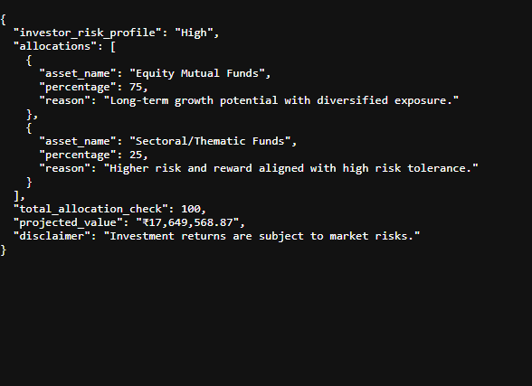
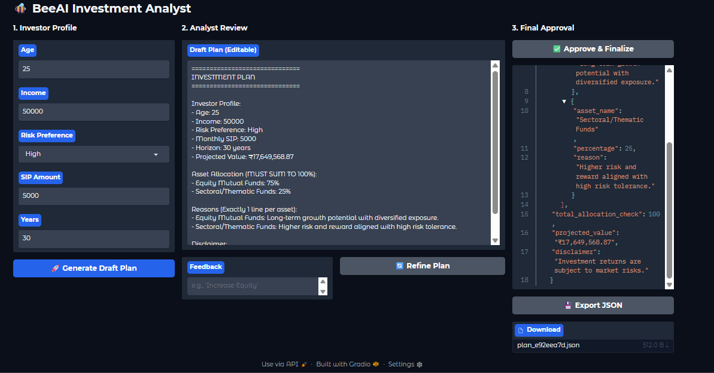
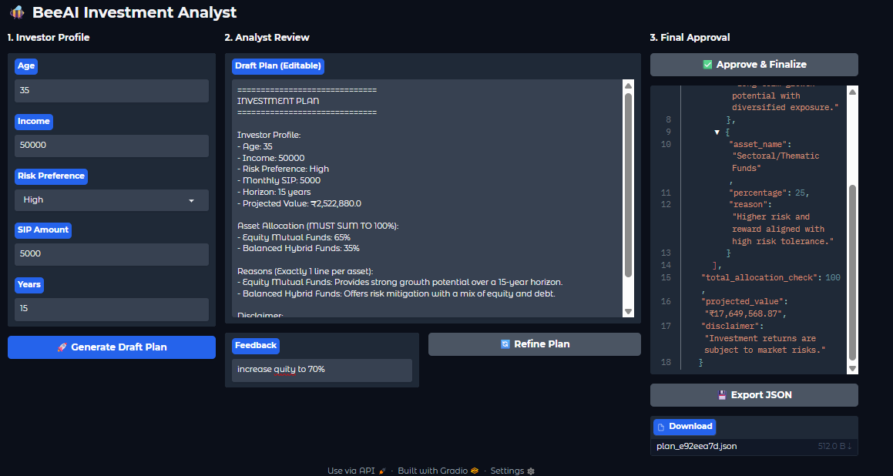
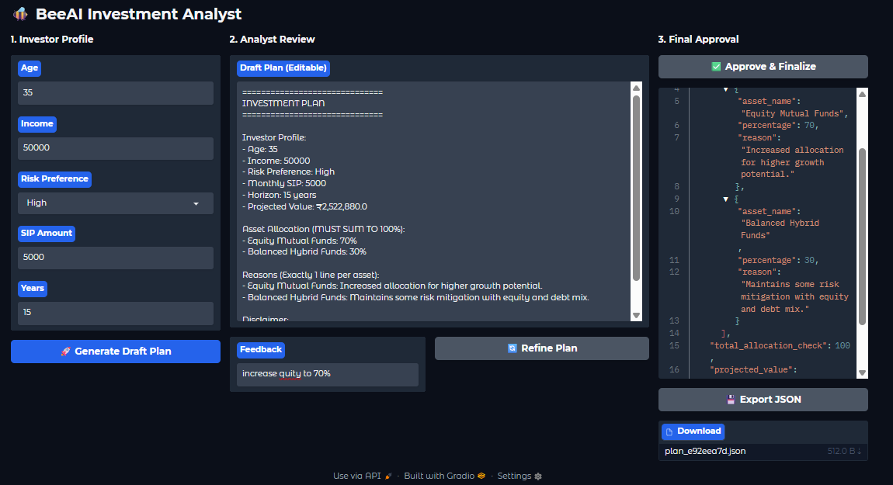

# 🐝 BeeAI Investment Analyst
**A Deterministic, Multi-Agent Investment Planning Workbench with Strict JSON Validation**

---

## 📖 Overview

The **BeeAI Investment Analyst** is an applied AI system that generates a **structured, validated investment plan** using a **true agentic workflow** built on the **BeeAI Framework**.

This system is designed as a **multi-step investment planning workbench**, where an agent:

- collects investor inputs
- consults a specialist agent (handoff)
- calls deterministic tools (SIP calculator, asset lookup)
- generates a draft plan in a strict template
- validates and converts it into **strict JSON**
- enforces allocation rules (**must sum to 100%**)
- supports **HITL (Human-in-the-Loop)** refinement
- exports the final plan as a downloadable JSON file

This project is **not** a chatbot, **not** a finance opinion generator, and **not** a stock prediction tool.

Every response is:
- grounded in a **strict output schema**
- validated via **Pydantic rules**
- constrained by **tool outputs**
- reproducible and automation-ready

---

## 🧠 What This System Does

The system enables a user to:

1. Enter an investor profile (Age, Income, Risk, SIP Amount, Horizon)
2. Generate a **draft investment plan**
3. Refine the draft using **feedback** (HITL loop)
4. Approve the plan for final validation
5. Convert the plan into **strict JSON**
6. Export the final JSON plan as a downloadable file

All execution paths are demonstrated below using **real system outputs**.

---

## 🛡️ Design Principles

### ✅ Agentic by Construction (BeeAI ReAct Agents)
This system uses **BeeAI Framework ReActAgent**, meaning the agent:
- reasons step-by-step
- decides which tool to call
- performs actions through tool invocation
- produces the final answer only after tool-backed reasoning

### ✅ Multi-Agent Workflow with Handoff
This system implements **two agents**:

- **Risk Specialist Agent**
  - validates risk profile logic
  - looks up allowed assets by risk level

- **Coordinator Agent**
  - orchestrates the full workflow
  - calls the Risk Specialist through a handoff tool
  - calls SIP calculator for deterministic projections
  - generates the final plan in strict format

This is a real **agent-to-agent orchestration**, not a single LLM call.

### ✅ Deterministic by Design
- Model locked: `openai:gpt-4.1-mini`
- `temperature = 0` (via BeeAI ChatModel defaults)
- Deterministic SIP math (no LLM math)
- Strict JSON validation (Pydantic)

### ✅ Strict Output Contract (Validated JSON)
The final output must satisfy:

- allocations must sum to **exactly 100**
- each allocation must include:
  - asset name
  - percentage
  - reason
- projected value must exist
- disclaimer must exist

If validation fails, the system auto-repairs and retries.

---

## 🚀 Key Capabilities (No Overclaim)

- Investor profile → structured investment plan generation  
- Multi-agent handoff (Coordinator → Risk Specialist)  
- Deterministic SIP future value calculation (tool + math)  
- Asset lookup from a local JSON dictionary  
- Strict template-based draft generation  
- HITL refinement loop (feedback-driven)  
- Pydantic-validated JSON output (allocations must sum to 100%)  
- Export-ready JSON file generation (UTF-8, ₹ symbol preserved)  

---

## 🧠 System Architecture
```
User Inputs (Age, Income, Risk, SIP, Horizon)
↓
Gradio Workbench UI
↓
Coordinator ReActAgent (BeeAI)
↓
(1) ConsultRiskSpecialist Tool ───────────────┐
↓ │
Risk Specialist ReActAgent (BeeAI) │
↓ │
RiskProfiler Tool + AssetDictionary Tool │
└──────────────────────────────────────┘
↓
(2) SIPCalculator Tool (Deterministic FV)
↓
Draft Plan (Strict Template)
↓
HITL Feedback Loop (Refine Draft)
↓
Strict Parsing + Pydantic Validation
↓
Final JSON Output
↓
Export JSON File (Download)
```

---

## 🧬 Agentic Systems Implemented (BeeAI Framework)

This project explicitly uses BeeAI agentic primitives:

### ✅ ReAct Agents
- `ReActAgent` is used for both agents
- Tools are invoked dynamically based on reasoning

### ✅ Tool System
Tools are implemented using BeeAI’s typed tool system:

- `SIPCalculatorTool`
- `AssetDictionaryTool`
- `RiskProfilerTool`
- `ConsultRiskSpecialistTool` (handoff wrapper)

### ✅ Handoff Pattern (Agent-as-a-Tool)
Because the Python SDK does not include a generic HandoffTool yet, this system implements:

- Specialist Agent wrapped inside a Tool
- Coordinator calls that tool
- Tool triggers the specialist agent run
- Tool returns the specialist’s final answer back to the coordinator

This is a clean and production-style workaround.

### ✅ Memory
- `UnconstrainedMemory()` is used for agent context
- The UI additionally stores structured session history in a runtime session store

---

## 🛠 Tech Stack

- **Language:** Python  
- **Framework:** BeeAI Framework  
- **Agent Type:** ReActAgent (multi-agent)  
- **Model:** GPT-4.1-mini  
- **Validation:** Pydantic (strict schema enforcement)  
- **UI:** Gradio  
- **Execution Environment:** Google Colab  
- **Data Source:** Local JSON asset dictionary  

---

## 📂 Project Structure
```
beeai-investment-analyst/
│── beeai_investment_workbench.py
│── BEE_ai_investment_agent_JSON_output.png
│── BEE_ai_investment_agent_test_1.png
│── BEE_ai_investment_agent_test_2_HITL_input.png
│── BEE_ai_investment_agent_test_2_HITL_output.png
│── README.md

```
---

## 🧪 Step-by-Step System Demonstration

### 1️⃣ Strict JSON Output (Validated Contract)

This screenshot demonstrates the system producing a **structured JSON output** after passing strict validation rules.



---

### 2️⃣ Test Run #1 — Full Agent Execution

This test demonstrates an end-to-end run of the system producing a complete investment plan.



---

### 3️⃣ HITL Test — Human Feedback Input

This screenshot captures the HITL workflow where the user provides feedback for refinement.



---

### 4️⃣ HITL Test — Refined Output

This screenshot captures the refined investment plan produced after the feedback loop.



---

## 🧬 Deterministic Tools (Executable, Not Theoretical)

This system intentionally avoids LLM math and instead uses deterministic tools.

### ✅ SIP Calculator Tool
- Computes future value using a deterministic formula
- Used both in:
  - BeeAI tool execution
  - fallback math helper in the UI pipeline

### ✅ Asset Dictionary Tool
- Uses a local JSON dictionary (`asset_dictionary.json`)
- Returns only allowed assets filtered by risk level
- No external APIs involved

### ✅ Risk Profiler Tool
- Implements deterministic rule:
  - If age > 60 and risk preference is high → downgrade to medium

---

## ⚠️ Limitations & Disclosure

- This system does not provide financial advice
- No live market feeds are used
- No stock price prediction is performed
- Asset universe is limited to the local dictionary
- This version focuses on:
  - agentic workflow correctness
  - schema validation
  - HITL refinement
  - exportable structured output

All screenshots represent **actual system executions**.

---

## ▶️ Usage

```bash
pip install beeai-framework openai pydantic gradio
python beeai_investment_workbench.py
```

👨‍💻 Author

Shubham Singh

📜 License

MIT License
