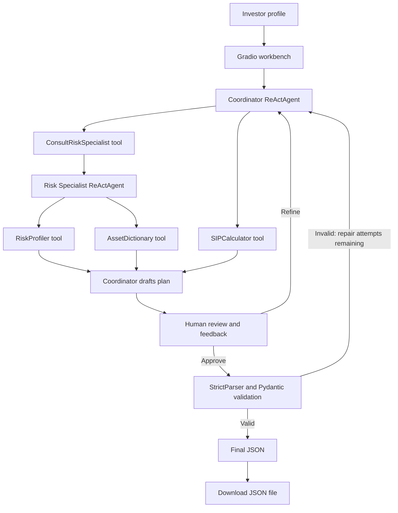

# BeeAI Investment Analyst

**A multi-agent investment-planning workbench with deterministic calculation tools, human feedback, and Pydantic-validated JSON output.**

[](https://www.python.org/) [](https://beeai-framework.dev/) [](https://www.gradio.app/) [](https://docs.pydantic.dev/) [](./LICENSE)

> **Financial-use notice:** This is a research and portfolio prototype, not a financial adviser or investment service. Its projections depend on assumptions, and generated asset allocations may be unsuitable for an individual. Do not use its output as personalized financial advice or as the sole basis for an investment decision. Verify all assumptions and consult a qualified financial professional where appropriate.

## Contents

- [Overview](#overview)
- [Capabilities](#capabilities)
- [Architecture](#architecture)
- [Agent and tool design](#agent-and-tool-design)
- [Validation and calculation behavior](#validation-and-calculation-behavior)
- [Technology stack](#technology-stack)
- [Repository structure](#repository-structure)
- [Demonstrations](#demonstrations)
- [Run in Google Colab](#run-in-google-colab)
- [Limitations and responsible use](#limitations-and-responsible-use)
- [Author](#author)
- [License](#license)

## Overview

BeeAI Investment Analyst is an interactive prototype that turns an investor profile into a structured draft investment plan. It uses the BeeAI Framework's `ReActAgent` for a Coordinator and a Risk Specialist. The Coordinator can consult the specialist through a custom tool wrapper and use a SIP calculation tool. A Gradio interface supports draft review, feedback-driven refinement, final validation, and JSON export.

The project focuses on agent orchestration, deterministic helper tools, structured output validation, and human-in-the-loop (HITL) review. It does **not** retrieve live financial data, predict stock prices, or verify that any proposed asset or return assumption is appropriate for a real investor.

## Capabilities

- **Investor profile input:** age, income, risk preference, monthly SIP amount, and investment horizon.
- **Multi-agent workflow:** a Coordinator agent can invoke a Risk Specialist through the `ConsultRiskSpecialistTool` wrapper.
- **Typed tool calls:** SIP projection, risk classification, and local asset lookup are implemented as BeeAI tools.
- **Draft generation and refinement:** review and edit the draft, then submit feedback for another generation pass.
- **Schema validation:** Pydantic models validate required output fields and ensure allocation percentages sum to exactly 100.
- **Validation repair attempts:** if parsing or model validation fails, the application asks the Coordinator to repair the draft, with a maximum of two repair attempts after the initial validation attempt.
- **JSON export:** export the finalized plan as UTF-8 JSON, preserving the rupee symbol.
- **Visible workflow:** the UI separates draft editing, feedback, final approval, validated JSON, and file export.

## Architecture



### Main workflow

1. The user provides an age, income, risk preference, SIP amount, and time horizon.
2. The application validates basic input ranges and calculates a projection using its configured assumed rate.
3. The Coordinator creates a draft and may call the Risk Specialist and SIP calculator tools.
4. The Risk Specialist can apply the defined risk rule and retrieve matching assets from the local asset dictionary.
5. The user reviews or edits the draft and can request refinements through feedback.
6. On approval, the parser converts the draft to structured data and Pydantic validates it.
7. A valid plan is displayed as JSON and can be exported to a file.

## Agent and tool design

### Coordinator agent

The Coordinator is a BeeAI `ReActAgent` with access to the custom risk-specialist wrapper and SIP calculator. Its instructions ask it to identify missing data, consult the specialist, obtain a projection, and produce a plan whose allocations sum to 100%.

### Risk Specialist agent

The specialist is a separate `ReActAgent` with access to the risk profiler and asset dictionary. The Coordinator invokes it via `ConsultRiskSpecialistTool`, which runs the specialist and returns its final text to the Coordinator.

### Tools

| Tool | Responsibility | Behavior in this project |
|---|---|---|
| `SIPCalculatorTool` | Future-value projection | Calculates a monthly SIP projection with a formula; it does not fetch market data. |
| `AssetDictionaryTool` | Asset lookup | Reads `asset_dictionary.json` and filters entries by the requested risk category. |
| `RiskProfilerTool` | Basic risk rule | Changes a `High` preference to `Medium` when age is greater than 60; otherwise it returns the supplied preference. |
| `ConsultRiskSpecialistTool` | Agent handoff | Runs the specialist agent and passes its response back to the Coordinator. |

The handoff is implemented as an application-defined tool wrapper rather than a platform-level handoff primitive.

## Validation and calculation behavior

### JSON contract

The final `InvestmentPlan` model contains:

- `investor_risk_profile`
- `allocations`, containing `asset_name`, integer `percentage`, and `reason` for each allocation
- `total_allocation_check`
- `projected_value`
- `disclaimer`

A Pydantic model validator calculates the total allocation and raises an error unless the sum is exactly `100`. The current schema requires the fields shown above, but it should not be interpreted as proof of financial suitability or correctness of the underlying analysis.

### SIP assumptions

The UI-side projection helper currently uses an assumed annual return of **12%** when preparing a draft. The tool also accepts a rate-of-return parameter when invoked by an agent. The displayed future value is a mathematical projection, not a forecast or guaranteed return; the assumed rate may not match actual investment performance.

### Asset dictionary

The notebook creates a local `asset_dictionary.json` with six example categories: Equity Index Fund, Mid Cap Fund, Debt Fund, Gold ETF, Liquid Fund, and Fixed Deposit. The dictionary contains illustrative risk labels, return ranges, and minimum holding horizons. These figures are configured sample data—not live quotes, independently verified forecasts, or guarantees.

## Technology stack

| Layer | Technology | Role |
|---|---|---|
| Language | Python | Application and tool implementation |
| Agent framework | BeeAI Framework | `ReActAgent`, memory, and typed tools |
| Model provider | OpenAI through BeeAI `ChatModel` | Drafting, refinement, and agent reasoning |
| Configured model | `openai:gpt-4.1-mini` | Primary model name in the checked-in script, with a `gpt-3.5-turbo` fallback path |
| Validation | Pydantic | Structure validation and allocation-total rule |
| User interface | Gradio | Investor inputs, editable draft, feedback, approval, JSON and download controls |
| Local data | JSON | Example asset dictionary |
| Intended execution environment | Google Colab | The checked-in source uses Colab-specific APIs and notebook syntax |

## Repository structure

```text
beeai-investment-analyst/
├── README.md
├── LICENSE
├── beeai_investment_workbench.py
├── BEE_ai_investment_agent_JSON_output.png
├── BEE_ai_investment_agent_test_1.png
├── BEE_ai_investment_agent_test_2_HITL_input.png
└── BEE_ai_investment_agent_test_2_HITL_output.png
```

`asset_dictionary.json` is generated by the notebook's data-setup cell when it runs; it was not present in the inspected repository directory listing.

## Demonstrations

The following screenshots are included in this repository and show the documented interface and example runs. They illustrate a small demonstration set and should not be treated as an independent evaluation of investment quality.

### Validated JSON output


### Test run: generated draft plan


### Human-in-the-loop: feedback input


### Human-in-the-loop: refined output


## Run in Google Colab

The checked-in `beeai_investment_workbench.py` was exported from a Colab notebook. It contains a notebook-style `!pip install` command and imports `google.colab.userdata`, so it is **not a standard standalone Python script that runs unchanged in a regular local terminal**.

1. Open the [BeeAI Investment Analyst notebook in Google Colab](https://colab.research.google.com/drive/1K-6x-S2_yuE4BRiEt_f2bAGTRMRkN5vf).
2. Add `OPENAI_API_KEY` in the Colab **Secrets** panel and grant the notebook access to it.
3. Run the dependency-installation and data-setup cell:

   ```python
   !pip install beeai-framework openai pydantic gradio
   ```

4. Run the remaining notebook cells in order. The setup cell writes `asset_dictionary.json` to the current working directory.
5. Use the Gradio interface to enter an investor profile, generate a draft, optionally refine it with feedback, approve the plan, and export the validated JSON.

For a local Python setup, first move dependency installation out of the source file and replace `google.colab.userdata` with an appropriate environment-variable or secret-management approach. Those adaptations are not included in the checked-in script.

## Limitations and responsible use

- **Not financial advice:** generated allocations and explanatory text are model output and may be wrong or unsuitable.
- **No live market data:** the project uses a local sample asset dictionary and hard-coded projection assumptions.
- **Projection assumptions:** the UI-side SIP estimate uses a 12% assumed annual rate; real returns, costs, taxes, and inflation may differ.
- **Rule-based risk adjustment is narrow:** the code only implements the specific age-over-60/high-risk downgrade described above. This is not a comprehensive risk assessment.
- **Validation is structural:** a 100% allocation total does not establish that allocations are sensible, diversified, or appropriate.
- **Parsing is template-dependent:** the parser expects labels and allocation lines in a particular text format. Pydantic validation cannot correct every semantic or financial error.
- **In-memory sessions:** session data is stored in a module-level runtime dictionary; it is not a durable database and may be lost when the process restarts.
- **External API and privacy:** model calls require an OpenAI API key. Do not submit sensitive personal or financial information unless the provider use is appropriate and authorized.
- **Colab dependency:** the repository script imports Colab-specific APIs and requires adaptation for other environments.

## Author

**Shubham Kumar Singh**  
GitHub: [@shubham-61291](https://github.com/shubham-61291)

## License

This project is licensed under the **MIT License**. See the [standalone `LICENSE` file](./LICENSE) in this directory. The full license text is reproduced below for clarity.

Copyright (c) 2026 Shubham Kumar Singh

Permission is hereby granted, free of charge, to any person obtaining a copy of this software and associated documentation files (the "Software"), to deal in the Software without restriction, including without limitation the rights to use, copy, modify, merge, publish, distribute, sublicense, and/or sell copies of the Software, and to permit persons to whom the Software is furnished to do so, subject to the following conditions:

The above copyright notice and this permission notice shall be included in all copies or substantial portions of the Software.

THE SOFTWARE IS PROVIDED "AS IS", WITHOUT WARRANTY OF ANY KIND, EXPRESS OR IMPLIED, INCLUDING BUT NOT LIMITED TO THE WARRANTIES OF MERCHANTABILITY, FITNESS FOR A PARTICULAR PURPOSE AND NONINFRINGEMENT. IN NO EVENT SHALL THE AUTHORS OR COPYRIGHT HOLDERS BE LIABLE FOR ANY CLAIM, DAMAGES OR OTHER LIABILITY, WHETHER IN AN ACTION OF CONTRACT, TORT OR OTHERWISE, ARISING FROM, OUT OF OR IN CONNECTION WITH THE SOFTWARE OR THE USE OR OTHER DEALINGS IN THE SOFTWARE.
