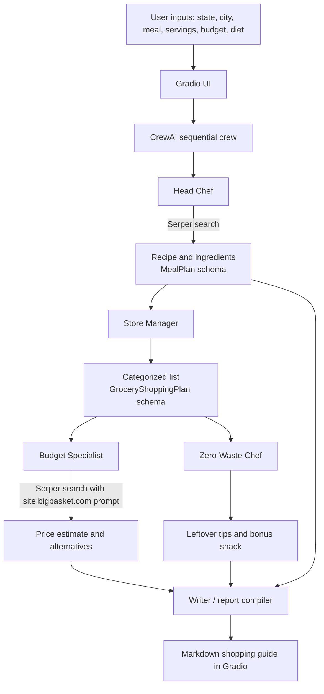
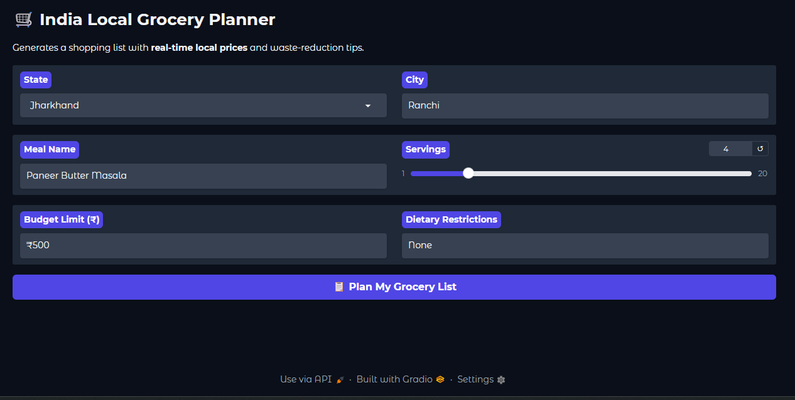

# CrewAI Local Grocery Planner (India)

**A multi-agent grocery-planning workbench for recipe discovery, categorized shopping lists, BigBasket-oriented price research, budget estimation, and leftover ideas.**

[](https://www.python.org/) [](https://www.crewai.com/) [](https://www.gradio.app/) [](https://serper.dev/) [](./LICENSE)

> **Accuracy notice:** This is a planning prototype. Grocery prices, pack sizes, quantities, recipe details, and budget totals are model-generated estimates informed by search results. They may be incorrect, stale, or unavailable for a particular delivery PIN code. Verify products and prices directly with the retailer before purchasing. The application does not place orders.

## Contents

- [Overview](#overview)
- [Features](#features)
- [How it works](#how-it-works)
- [Architecture](#architecture)
- [Technology stack](#technology-stack)
- [Repository contents](#repository-contents)
- [Interface and demonstrations](#interface-and-demonstrations)
- [Run in Google Colab](#run-in-google-colab)
- [Local execution](#local-execution)
- [Configuration and data](#configuration-and-data)
- [Known limitations](#known-limitations)
- [Potential next steps](#potential-next-steps)
- [Security and privacy](#security-and-privacy)
- [Author](#author)
- [License](#license)

## Overview

CrewAI Local Grocery Planner turns a meal request into a structured grocery guide for a selected Indian state and city. A sequential CrewAI pipeline assigns recipe research, list organization, price research, leftover planning, and final report writing to five specialized agents.

The Gradio interface collects the location, meal, serving count, budget, and optional dietary restrictions. The result is a Markdown guide containing the recipe and ingredients, a categorized shopping list, search-informed price estimates, budget suggestions, and ideas for using likely leftovers.

This is a **multi-agent workflow prototype**, not a grocery-ordering application or a guaranteed price-comparison service. Although intermediate recipe and shopping-list tasks use Pydantic output models, the price-research and final report tasks return free-form text.

## Features

- **Location-aware search context:** passes the selected city, state, and India as the location context to Serper.
- **Recipe discovery:** searches for a requested meal and asks for a structured ingredient list.
- **Categorized grocery list:** groups ingredients by store section through a Pydantic-backed `GroceryShoppingPlan` task.
- **BigBasket-oriented pricing:** asks the price-research agent to search using `site:bigbasket.com` queries.
- **Budget suggestions:** asks the pricing agent to estimate the list total and suggest cheaper alternatives when the estimate exceeds the entered budget.
- **Leftover ideas:** suggests likely surplus ingredients and a bonus snack.
- **Sequential multi-agent execution:** runs five agents across five dependent CrewAI tasks.
- **Gradio interface:** provides inputs for state, city, meal, servings, budget, and dietary restrictions, then displays a Markdown report.
- **Inspectable examples:** includes two recorded run logs and two generated report PDFs in the repository.

## How it works

1. The user chooses an Indian state, enters a city and meal, selects servings, and provides a budget and dietary restrictions.
2. The **Head Chef** uses Serper search to find recipe information and returns a `MealPlan` with a meal name and ingredient list.
3. The **Store Manager** turns the ingredients into categorized items using the `GroceryShoppingPlan` schema.
4. The **Budget Specialist** searches for prices with a prompt that specifies BigBasket-only queries, estimates cost, and suggests alternatives if needed.
5. The **Zero-Waste Chef** identifies likely leftovers and suggests a bonus snack.
6. The **Writer** combines the task outputs into a final Markdown grocery guide.
7. The Gradio interface displays the result.

## Architecture



### Agents and tasks

| Agent | Responsibility | Output / contract |
|---|---|---|
| Head Chef | Search for a recipe and identify ingredients | `MealPlan`: meal name and ingredients |
| Store Manager | Organize ingredients into shopping categories and quantities | `GroceryShoppingPlan`: item list, quantity, category, optional estimated price, total estimate field |
| Budget Specialist | Search price information and reason about the budget | Free-form price breakdown and possible alternatives |
| Zero-Waste Chef | Identify likely leftovers and suggest a bonus snack | Free-form leftover suggestions |
| Writer | Combine recipe, shopping list, pricing, and leftover information | Final Markdown report |

## Technology stack

| Layer | Implementation |
|---|---|
| Language | Python |
| Agent orchestration | CrewAI `Agent`, `Task`, `Crew`, `Process.sequential` |
| Model | `gpt-4.1-mini`, configured through CrewAI's `LLM` wrapper |
| Search | `SerperDevTool` |
| Schemas | Pydantic models: `MealPlan`, `GroceryItem`, `GroceryShoppingPlan` |
| Interface | Gradio Blocks |
| Runtime shown by source | Google Colab |
| Local data | `asset_dictionary.json` is written during notebook setup, although the grocery-planning pipeline shown in this repository does not use that dictionary for its price-research workflow |

## Repository contents

```text
crewai-local-grocery-planner/
├── README.md
├── LICENSE
├── crew_ai_local_grocery_planner.py
├── interface.png
├── test_1_agent_log.docx
├── test_1_output.pdf
├── test_2_agent_log.docx
└── test_2_output.pdf
```

The `LICENSE` file is included as the repository's explicit license notice. Keep it at the project root when publishing or redistributing this project under the MIT License.

## Interface and demonstrations

### Gradio interface

The interface collects the location and meal constraints and displays the generated grocery guide.



### Recorded run 1

- [Agent execution log — Test 1](./test_1_agent_log.docx)
- [Generated grocery guide — Test 1](./test_1_output.pdf)

### Recorded run 2

- [Agent execution log — Test 2](./test_2_agent_log.docx)
- [Generated grocery guide — Test 2](./test_2_output.pdf)

These files are recorded examples from the project. They demonstrate particular runs, not repeatable accuracy or guaranteed results for other cities, meals, or budgets.

## Run in Google Colab

The checked-in `crew_ai_local_grocery_planner.py` is exported from a Colab notebook. It contains notebook-specific syntax (`!pip`) and imports `google.colab.userdata`, so **it is not a standalone Python script that can be run unchanged in an ordinary local terminal**.

The source identifies the original notebook here:

[Open the CrewAI Local Grocery Planner notebook in Google Colab](https://colab.research.google.com/drive/12MyzDVDsoa4e5VD6ULEhAwLpXBlAhYY9)

1. Open the notebook in Google Colab.
2. Add `OPENAI_API_KEY` and `SERPER_API_KEY` in **Secrets** and grant the notebook access to them.
3. Run the dependency-installation cell. The source installs `crewai`, `crewai-tools`, `gradio`, and `pydantic`.
4. If prompted by the notebook cell, restart the runtime after installation.
5. Run the setup, agent/task, and Gradio UI cells in order.
6. Open the Gradio interface, enter the meal details, and submit the request.

Do not paste API keys directly into notebook cells or commit them to source control.

## Local execution

Local execution requires adapting the notebook-exported source first:

- Move the `!pip install ...` command into a terminal command or notebook setup cell.
- Replace `google.colab.userdata` secret access with environment-variable loading or another local secret manager.
- Ensure compatible versions of CrewAI, `crewai-tools`, Gradio, Pydantic, and their dependencies are installed.
- Set `OPENAI_API_KEY` and `SERPER_API_KEY` before starting the application.

The local adaptation is not supplied by the current checked-in script. After adapting it, a typical dependency installation is:

```bash
python -m pip install -U crewai crewai-tools gradio pydantic
```

Then run the adapted script from its project directory:

```bash
python crew_ai_local_grocery_planner.py
```

Do not run this command against the unchanged Colab-exported file in a normal Python interpreter; the notebook-only syntax and imports will fail.

## Configuration and data

### Required secrets

| Secret | Purpose |
|---|---|
| `OPENAI_API_KEY` | Authenticates the model calls made through CrewAI's LLM wrapper |
| `SERPER_API_KEY` | Authenticates Serper web searches |

### Default interface values

The current source initializes the UI with the following example values:

| Input | Default |
|---|---|
| State | Jharkhand |
| City | Ranchi |
| Meal | Paneer Butter Masala |
| Servings | 4 |
| Budget | `₹500` |
| Dietary restrictions | `None` |

These are UI defaults, not recommendations or validated assumptions about a user's needs.

### Search and budget behavior

The pricing task's prompt instructs the agent to use `site:bigbasket.com` queries and provide price estimates for the selected location. This is a **prompt-level constraint**, not a deterministic domain allow-list enforced by the application code. Results depend on Serper's returned snippets and the model's interpretation. The budget is also an instruction to the agent rather than a hard numeric postcondition enforced by code.

## Known limitations

- **Prices are estimates:** search snippets can refer to a different size, brand, pack, or variant; local availability and delivery catalogs may differ.
- **No guaranteed BigBasket-only enforcement:** the task prompt requests BigBasket-specific search, but the code does not independently validate every result URL against an allow-list.
- **Budget compliance is advisory:** the pricing task reasons about the budget in free-form text. The current implementation does not parse all item prices into a deterministic numeric total and reject plans over budget.
- **Quantities are not normalized deterministically:** the workflow has no dedicated unit-conversion system to reliably convert pieces, grams, and pack sizes.
- **Category assignments may vary:** item categories are model-generated, so similar ingredients may occasionally be assigned inconsistently.
- **Only some intermediate outputs are schema-backed:** the recipe and shopping-list tasks specify Pydantic models; the pricing and final report tasks do not enforce a comparable structured price schema.
- **Recipe quality depends on search:** results can be incomplete, duplicated, regionally different, or inconsistent with the user's dietary needs. Verify ingredients and cooking steps.
- **No ordering integration:** the application generates a plan but does not add items to a cart, place an order, or verify retailer availability.
- **Colab-specific execution:** the checked-in source requires adaptation before standard local Python execution.
- **No formal evaluation suite is included:** the screenshots and two example runs do not establish pricing accuracy, budget compliance, recipe authenticity, or performance across all Indian cities.

## Potential next steps

1. **Validate price evidence:** extract numeric prices, pack sizes, and product links into a schema; reject results without an identifiable price and unit size.
2. **Enforce a hard budget rule:** compute item totals numerically and trigger a substitution loop when the total exceeds the budget.
3. **Normalize quantities:** add deterministic conversions for grams, kilograms, pieces, and common produce estimates, with assumptions explicitly shown.
4. **Structure price-research results:** validate product name, retailer URL, pack size, price, currency, location signal, and evidence confidence.
5. **Add additional retailer sources deliberately:** allow users to select retailers, and validate each source instead of relying only on prompt instructions.
6. **Add report export:** provide a verified downloadable PDF or JSON export from the generated final plan.
7. **Add repeatable checks:** create test cases for malformed search snippets, missing prices, budget overflow, dietary restrictions, and inconsistent quantities.

## Security and privacy

- Keep API keys in Colab Secrets or a secure local secret manager.
- Do not commit credentials, `.env` files, or secrets in notebooks.
- Do not submit private addresses, sensitive dietary/medical information, or other personal data unless you understand the data handling of the model and search providers.
- Use a suitable access-control setup before exposing the Gradio interface beyond your own development session.
- Review the generated plan before relying on it; the system does not verify retailer availability or guarantee allergen safety.

## Author

**Shubham Kumar Singh**

- GitHub: [@shubham-61291](https://github.com/shubham-61291)
- Repository: [genai-retrieval-agentic-engineering](https://github.com/shubham-61291/genai-retrieval-agentic-engineering/tree/main/crewai-local-grocery-planner)

## License

This project is licensed under the MIT License. See the [standalone `LICENSE` file](./LICENSE) in the project root. The full license text is reproduced below for clarity.

Copyright (c) 2026 Shubham Kumar Singh

Permission is hereby granted, free of charge, to any person obtaining a copy of this software and associated documentation files (the "Software"), to deal in the Software without restriction, including without limitation the rights to use, copy, modify, merge, publish, distribute, sublicense, and/or sell copies of the Software, and to permit persons to whom the Software is furnished to do so, subject to the following conditions:

The above copyright notice and this permission notice shall be included in all copies or substantial portions of the Software.

THE SOFTWARE IS PROVIDED "AS IS", WITHOUT WARRANTY OF ANY KIND, EXPRESS OR IMPLIED, INCLUDING BUT NOT LIMITED TO THE WARRANTIES OF MERCHANTABILITY, FITNESS FOR A PARTICULAR PURPOSE AND NONINFRINGEMENT. IN NO EVENT SHALL THE AUTHORS OR COPYRIGHT HOLDERS BE LIABLE FOR ANY CLAIM, DAMAGES OR OTHER LIABILITY, WHETHER IN AN ACTION OF CONTRACT, TORT OR OTHERWISE, ARISING FROM, OUT OF OR IN CONNECTION WITH THE SOFTWARE OR THE USE OR OTHER DEALINGS IN THE SOFTWARE.
