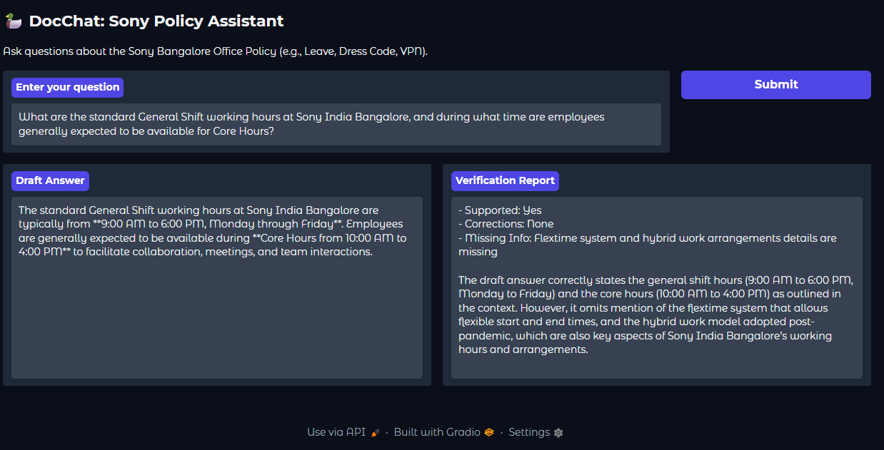
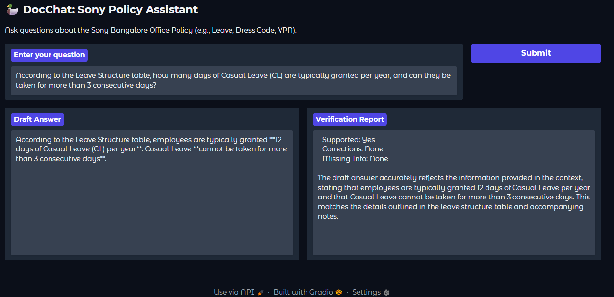
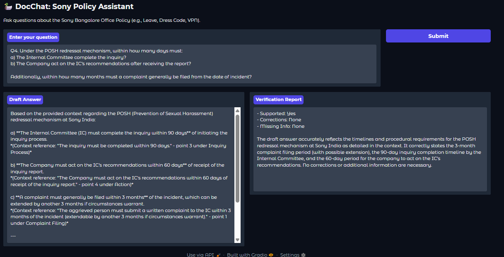
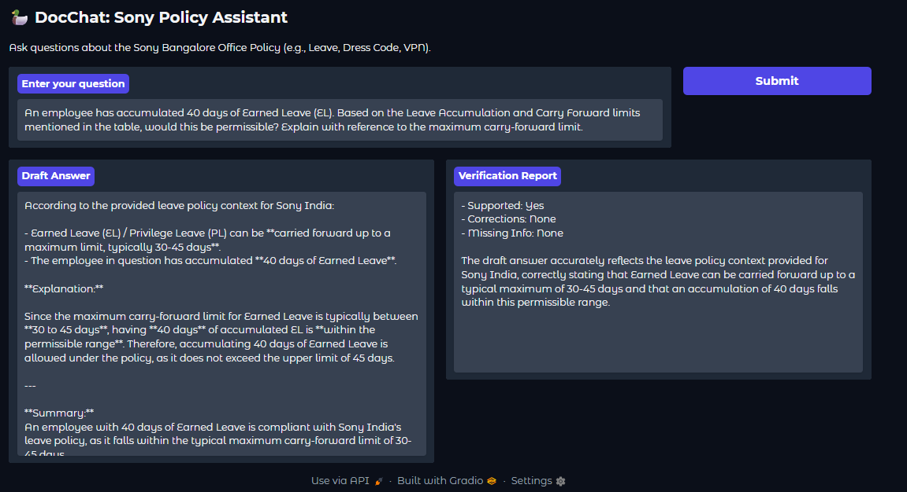
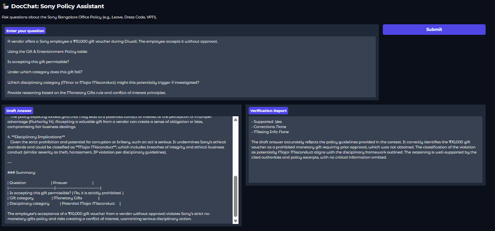
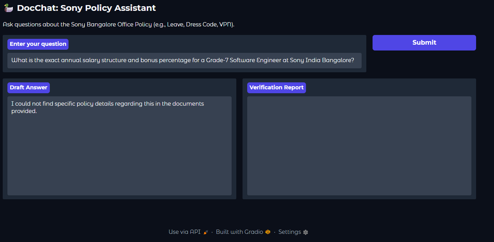

# DocChat: Hybrid Policy Assistant

**A document-question-answering prototype using Docling conversion, BM25 plus Chroma retrieval, and a LangGraph relevance/draft/review workflow.**

[](https://www.python.org/) [](https://www.langchain.com/langgraph) [](https://docling-project.github.io/docling/) [](https://www.trychroma.com/) [](../LICENSE)

## Overview

DocChat converts uploaded policy documents into Markdown with Docling, splits the text into retrievable chunks, and builds a hybrid retriever combining BM25 keyword retrieval and Chroma vector search. A LangGraph flow checks relevance, drafts an answer when it deems the context sufficient, and generates a separate verification report.

The workflow is evidence-assisted, not a hard technical guarantee that the model can use no outside knowledge or that every answer is correct.

## Architecture

```text
Colab file upload (before UI launch)
  -> Docling converter -> Markdown
  -> MarkdownHeaderTextSplitter (fallback: recursive chunks)
  -> BM25 retriever (k=15) + Chroma retriever (k=15)
  -> EnsembleRetriever (weights 0.4 / 0.6)
  -> LangGraph relevance gate
       ├─ relevant -> answer draft -> verification report
       └─ not relevant -> abstention message
  -> Gradio fields: draft answer + verification report
```

## Retrieval and model configuration

| Setting | Checked-in value |
|---|---|
| LLM | `gpt-4.1-mini`, temperature `0` |
| Document conversion | Docling `DocumentConverter` -> Markdown |
| Primary chunking | `MarkdownHeaderTextSplitter` on H1/H2/H3 |
| Fallback chunking | `RecursiveCharacterTextSplitter`, chunk size 1,000, overlap 200 |
| Keyword retrieval | `BM25Retriever`, `k=15` |
| Vector store | In-memory Chroma using `OpenAIEmbeddings`, `k=15` |
| Hybrid ensemble weights | BM25 `0.4`, vector `0.6` |
| Graph nodes | relevance check, research/draft, verification |

The current script uploads documents via `google.colab.files.upload()` before building and launching the Gradio UI. Multiple successfully parsed files are joined into one content string. The user does not upload documents through the displayed Gradio form in this version.

## Demonstration screenshots

### Working hours and core hours



### Leave structure / casual leave



### POSH redressal timelines



### Earned-leave carry-forward question



### Gifts and entertainment policy



### Out-of-scope question



## Run in Google Colab

The checked-in script includes a `!pip` command and imports `google.colab.userdata` and `google.colab.files`. Use it as notebook code or adapt those parts before standard local execution.

1. Add `OPENAI_API_KEY` to Colab Secrets and grant notebook access.
2. Install the dependencies:

   ```bash
   pip install -U "langchain==0.2.1" "langchain-community==0.2.1" langchain-openai langgraph "docling[all]" chromadb gradio rank_bm25 pypdf python-docx unstructured
   ```

3. Run the source cell. When prompted in Colab, upload the policy file(s). The script then converts documents, constructs the hybrid retriever, and launches Gradio.
4. Ask a question and review both output fields.

## Known limitations and safety notes

- The relevance-check error handler currently returns `is_relevant = yes` when the model call fails. This is fail-open behavior, not fail-closed; it may allow an answer attempt when relevance checking errors.
- The final “verification” is another prompt to an LLM. It is not an independent proof of correctness and can miss or introduce errors.
- Answers do not include document/page/section citations.
- The uploaded content is joined as Markdown; per-document provenance is not preserved in the final answer.
- The thread ID is hard-coded, and the demo does not implement multi-user authentication or isolation.
- `demo.launch(share=True, debug=True)` creates a public share link. Do not upload confidential policies or employee data to an exposed demo without an approved data-handling basis.
- Very large or complex tables may not survive document conversion and chunking without loss.

## Repository files

```text
docchat-hybrid-policy-assistant/
├── README.md
├── doc_chat.py
├── Doc_chat_test_1.png
├── Doc_chat_test_2.png
├── Doc_chat_test_3.png
├── Doc_chat_test_4.png
├── Doc_chat_test_5.png
└── Doc_chat_test_6.png
```

## Author

**Shubham Kumar Singh**

## License

This project is licensed under the **MIT License**. The complete license text is reproduced below and is also available in the repository's [`LICENSE`](../LICENSE) file.

```text
MIT License

Copyright (c) 2026 Shubham Kumar Singh

Permission is hereby granted, free of charge, to any person obtaining a copy
of this software and associated documentation files (the "Software"), to deal
in the Software without restriction, including without limitation the rights
to use, copy, modify, merge, publish, distribute, sublicense, and/or sell
copies of the Software, and to permit persons to whom the Software is
furnished to do so, subject to the following conditions:

The above copyright notice and this permission notice shall be included in all
copies or substantial portions of the Software.

THE SOFTWARE IS PROVIDED "AS IS", WITHOUT WARRANTY OF ANY KIND, EXPRESS OR
IMPLIED, INCLUDING BUT NOT LIMITED TO THE WARRANTIES OF MERCHANTABILITY,
FITNESS FOR A PARTICULAR PURPOSE AND NONINFRINGEMENT. IN NO EVENT SHALL THE
AUTHORS OR COPYRIGHT HOLDERS BE LIABLE FOR ANY CLAIM, DAMAGES OR OTHER
LIABILITY, WHETHER IN AN ACTION OF CONTRACT, TORT OR OTHERWISE, ARISING FROM,
OUT OF OR IN CONNECTION WITH THE SOFTWARE OR THE USE OR OTHER DEALINGS IN THE
SOFTWARE.
```
