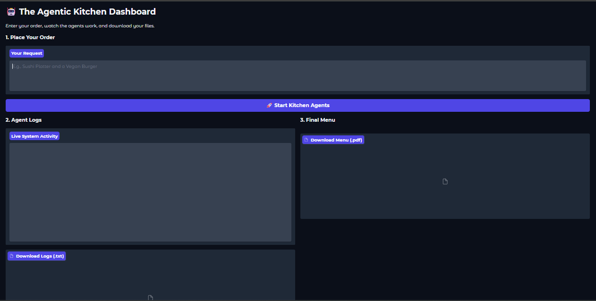
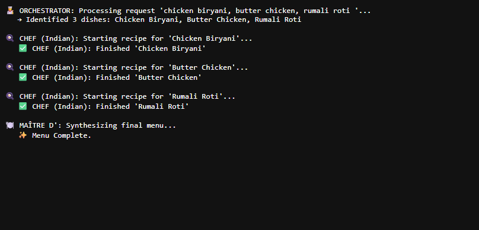

# 🧑‍🍳 LangGraph Orchestrator–Worker System  
**A Deterministic Multi-Agent Orchestration Pattern with Worker Fan-Out, Live Logs, and PDF Artifact Generation**

---

## 📖 Overview

The **LangGraph Orchestrator–Worker System** is an applied **agentic orchestration project** that demonstrates a clean, production-style multi-agent workflow using **LangGraph**.

This system is designed as a **true orchestration graph**, where:

- an **Orchestrator agent** breaks a user request into structured tasks  
- multiple **Worker agents** execute task-level outputs (fan-out)  
- a **Synthesizer agent** consolidates all worker outputs into a final artifact  
- the system produces:
  - **live execution logs**
  - a **downloadable log file**
  - a **downloadable PDF artifact**

This project is **not** a single-prompt script and **not** a chatbot.

It is a **graph-native orchestration system** implemented using:

- LangGraph `StateGraph`
- Worker fan-out via `Send()`
- Structured output contracts via **Pydantic**
- Deterministic LLM configuration (`temperature = 0`)
- Artifact generation pipeline (Markdown → HTML → PDF)
- Gradio dashboard UI for execution and downloads

---

## 🧠 What This System Does

The system enables a user to:

1. Enter a multi-item request (example: `"chicken biryani, butter chicken, rumali roti"`)
2. Orchestrator parses it into **structured dish tasks**
3. Worker chefs generate recipes for each dish
4. Synthesizer merges outputs into a final formatted guide
5. System generates:
   - **Live execution logs**
   - **agent_logs.txt**
   - **fancy_menu.pdf**

All execution paths are demonstrated below using **real system outputs**.

---

## 🛡️ Design Principles

### ✅ Agentic by Construction (LangGraph StateGraph)

This system is built using LangGraph’s graph execution primitives:

- `StateGraph`
- `START`, `END`
- Conditional fan-out edges
- Shared typed state
- Deterministic merging via `operator.add`

This is a true orchestration pipeline, not sequential scripting.

---

### ✅ Orchestrator → Worker Fan-Out → Synthesizer

The workflow implements the classic orchestration pattern:

- **Orchestrator Node**
  - Converts raw user request into structured tasks
  - Uses strict Pydantic schema output

- **Worker Nodes**
  - Each worker receives one structured task
  - Generates task output independently
  - Emits logs for traceability

- **Synthesizer Node**
  - Merges worker outputs into a final formatted response

---

### ✅ Deterministic by Design

- Model locked: `gpt-4.1-mini`
- `temperature = 0`
- Structured outputs enforced through schema validation
- Artifact pipeline is reproducible and consistent

---

### ✅ Strict Output Contract (Pydantic Structured Tasks)

The orchestrator produces tasks using a strict schema:

- Dish name
- Cuisine
- Notes

This ensures the workers always receive clean structured inputs.

---

### ✅ Execution Traceability

This system produces a full trace of execution through:

- live logs in the UI
- downloadable log file (`agent_logs.txt`)

This is critical for debugging and auditability.

---

### ✅ Artifact Generation (PDF)

The final synthesized output is converted into a downloadable PDF:

- Markdown output
- HTML conversion
- PDF rendering via `xhtml2pdf`

This demonstrates real-world "LLM output → deliverable artifact" engineering.

---

## 🚀 Key Capabilities (No Overclaim)

- Orchestrator-driven task decomposition  
- Worker fan-out execution using LangGraph `Send()`  
- Pydantic structured task schema  
- Deterministic configuration (`temperature = 0`)  
- Live logs displayed inside Gradio UI  
- Downloadable logs (`agent_logs.txt`)  
- PDF artifact generation pipeline  
- Downloadable PDF (`fancy_menu.pdf`)  

---

## 🧠 System Architecture

```text
User Request
↓
Gradio Dashboard UI
↓
Orchestrator Node (Pydantic structured output)
↓
Worker Fan-Out via Send()
    ├── Worker 1 (Dish 1)
    ├── Worker 2 (Dish 2)
    ├── Worker 3 (Dish 3)
    └── ...
↓
Synthesizer Node
↓
Final Markdown Guide
↓
Markdown → HTML → PDF
↓
Downloadable Artifact + Logs
```
🛠 Tech Stack

Language: Python

Framework: LangGraph

LLM: OpenAI gpt-4.1-mini

Validation: Pydantic

UI: Gradio

Artifact Generation: markdown + xhtml2pdf

Execution Environment: Google Colab

📂 Project Structure
```
langgraph-orchestrator-worker-system/
│── langgraph_orchestrator_worker_pattern.py
│── agentlog.png
│── inerface.png
│── output_pdf.pdf
│── pdf_dload.pdf
│── README.md
```
### 🧪 Step-by-Step System Demonstration
## 1️⃣ Agent Execution Logs (Terminal)
This screenshot shows the real execution trace:

orchestrator task split

worker execution

synthesis completion


## 2️⃣ Full System UI (Gradio Dashboard)
This screenshot shows the complete dashboard including:

input box

live agent logs

log download

PDF download


## 3️⃣ Example PDF Output (Download)

This system produces a final formatted PDF artifact (**Markdown → HTML → PDF**) that can be downloaded directly from the UI.

## 📄 Output PDF (Generated Artifact)
- **Download:** [output_pdf.pdf](output_pdf.pdf)

## 🖼️ PDF Download Proof (UI Screenshot)

## 4️⃣ Full System UI (Gradio Dashboard)

This screenshot shows the complete dashboard including:
- input box
- live agent logs
- log download
- PDF download



### 5️⃣ Agent Execution Logs (Terminal)

This screenshot shows the real execution trace:
- orchestrator task split
- worker execution
- synthesis completion



## ⚠️ Limitations & Disclosure
This project is a workflow + orchestration demonstration

The content domain is intentionally simple (food recipes) to highlight the orchestration pattern

No external APIs are used (besides the LLM)

The focus is on:

orchestration correctness

structured task routing

traceable logs

artifact generation

All screenshots and PDFs are from real executions.

▶️ Usage
pip install langchain langchain-openai pydantic langgraph gradio markdown xhtml2pdf
python langgraph_orchestrator_worker_pattern.py

👨‍💻 Author

Shubham Singh

📜 License

MIT License


