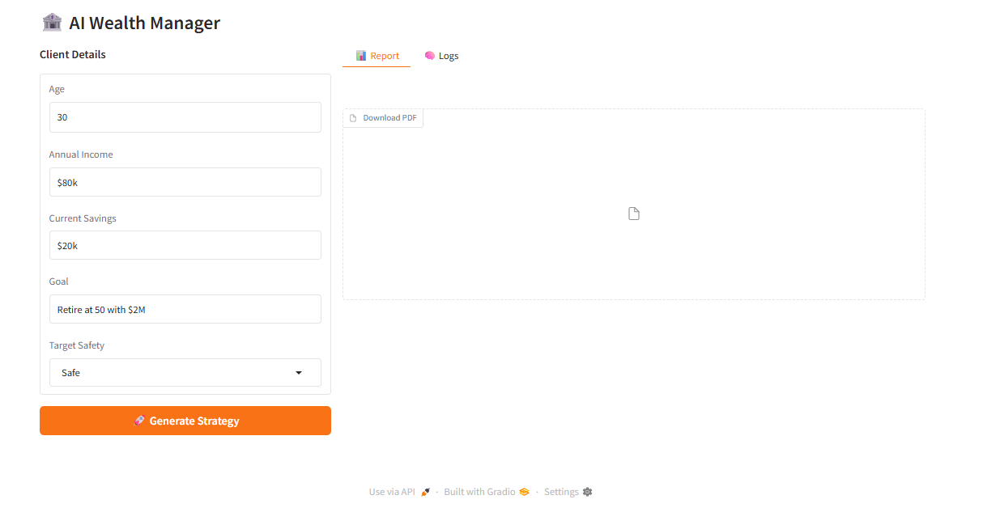

# 🏦 LangGraph Reflexion Investment Agent
**A Multi-Persona Reflexion Loop for Risk-Calibrated Investment Strategy Generation (LangGraph + Pydantic + PDF Export)**

---

## 📖 Overview

The **LangGraph Reflexion Investment Agent** is an applied agentic system that generates an **investment strategy**, then **self-corrects** it using a strict **evaluate → refine → retry** workflow.

This project is designed as a **portfolio-grade agentic workflow demo**, where:

- an aggressive investor persona drafts a plan
- a strict evaluator persona grades it against a target risk grade
- a balanced persona refines the plan using critique
- the workflow loops until the plan matches the target grade (or max retries)
- the final result is exported as a **professional PDF report**
- logs are saved as downloadable artifacts

This is **not** a stock prediction tool and **not** a market-data system.

It is a clean demonstration of:

✅ LangGraph orchestration  
✅ Reflexion loops  
✅ Structured evaluation (Pydantic schema)  
✅ End-to-end UI + artifact export  

---

## 🧠 What This System Does

The system enables a user to:

1. Enter structured client details:
   - Age  
   - Annual Income  
   - Current Savings  
   - Goal  
2. Select a **Target Safety Grade**
3. Generate a strategy using a multi-step agentic workflow
4. Automatically refine until the evaluator assigns the target grade
5. Download:
   - **PDF Report**
   - **Execution Logs**

---

## 🛡️ Design Principles

### ✅ Agentic by Construction (LangGraph State Machine)
This system uses **LangGraph** to build a real agent workflow:

- state is explicitly tracked
- nodes are deterministic in flow (generator → evaluator → router)
- retry logic is controlled by a router function
- maximum loop guard prevents infinite execution

---

### ✅ Reflexion Loop (Plan → Critique → Refine)
This project implements a reflexion-style loop:

- **Draft Plan**
- **Grade + Critique**
- **Refine Plan**
- **Re-evaluate**
- Repeat until success

Logs clearly show the system correcting itself in cycles.

---

### ✅ Structured Evaluator Output (Pydantic)
The evaluator is constrained using:

- `llm.with_structured_output(Feedback)`

Meaning:

- the evaluator must return a valid grade from:
  - `High Risk`
  - `Moderate Risk`
  - `Low Risk`
  - `Safe`
- plus a critique string

This prevents messy, unstructured evaluator responses.

---

### ✅ No Overclaim
This project is intentionally scoped as:

- an agentic orchestration demo
- a reflexion-loop demo
- a portfolio-quality UI + artifact pipeline

It does **not**:

- fetch live market data
- optimize allocations mathematically
- guarantee deterministic investment results

---

## 🚀 Key Capabilities

- Multi-persona investment plan generation  
- Reflexion loop (evaluate → refine → retry)  
- Strict evaluator grading using Pydantic schema  
- Risk-grade targeting (Safe / Low / Moderate / High)  
- Loop guard (max 5 retries)  
- Gradio UI with structured input fields  
- Downloadable artifacts:
  - PDF investment report  
  - agent execution logs  

---

## 🧠 System Architecture

```text
User Inputs (Age, Income, Savings, Goal, Target Grade)
↓
Gradio UI
↓
LangGraph Workflow
   ├── Generator Node
   │     ├── Draft 1: Cathie Wood persona
   │     └── Retry: Ray Dalio persona
   ↓
   ├── Evaluator Node (Warren Buffett persona)
   │     └── Structured Output (Pydantic Feedback schema)
   ↓
   ├── Router Node
   │     ├── If grade matches target → END
   │     ├── If loops >= 5 → END
   │     └── Else → retry generator
↓
Final Investment Plan
↓
PDF Export + Log Export
```
🧬 Multi-Persona Agents Implemented
This project simulates a multi-agent workflow using role prompts:

🚀 Generator Persona (Draft 1)
Cathie Wood style

Aggressive growth / disruptive innovation

Produces the first draft

⚖️ Refinement Persona (Retries)
Ray Dalio style

Balanced, critique-driven refinement

Revises the plan to match target risk grade

🧐 Evaluator Persona (Strict Critic)
Warren Buffett style

Assigns a strict grade and critique

Output enforced via Pydantic schema

🛠 Tech Stack
Language: Python

Workflow Framework: LangGraph

LLM Wrapper: LangChain

Model: gpt-4.1-mini

Validation: Pydantic structured output

UI: Gradio

PDF Export: xhtml2pdf + markdown

Execution Environment: Google Colab

📂 Project Structure
```
langgraph_reflexion_investment_agent/
│── README.md
│── langgraph_reflexion_investment_agent.py
│── interface.png
│── agent_log_test_1.md
│── agent_log_test_2.md
│── pdf_output_test_1.pdf
│── pdf_output_test_2.pdf
│── test_1.pdf
│── test_2.pdf
```
### 🧪 Step-by-Step System Demonstration (Real Outputs)
1️⃣ Gradio Workbench UI (Structured Inputs)
This screenshot shows the final UI:

Proper fields (Age, Income, Savings, Goal)

Target Safety dropdown

Tabs for Report + Logs

Download PDF button



2️⃣ Test Run #1 — Reflexion Loop (Safe Target)
This run demonstrates:

Draft 1 generated (Cathie Wood)

Evaluator grades it High Risk

Refinement occurs (Ray Dalio)

Evaluator grades final output Safe

Total cycles: 2

📄 Logs: agent_log_test_1.md
📑 PDF: pdf_output_test_1.pdf

3️⃣ Test Run #2 — High Risk Target
This run demonstrates:

Draft plan generated

Evaluator immediately assigns High Risk

Total cycles: 1

📄 Logs: agent_log_test_2.md
📑 PDF: pdf_output_test_2.pdf

🧾 Output Artifacts
This system produces two portfolio-grade artifacts:

✅ Professional PDF Report
Generated from the final investment plan:

headings

tables

allocations

evaluator critique included at the end

Example outputs:

test_1.pdf

test_2.pdf

✅ Execution Logs
Logs capture:

generator persona used

evaluator grade assigned

critique summary

cycle count

Example logs:

agent_log_test_1.md

agent_log_test_2.md

### ⚠️ Limitations & Disclosure
This system does not provide financial advice

No live market feeds are used

No price prediction is performed

Allocation math is not tool-validated

Output quality depends on model behavior (gpt-4.1-mini)

This version focuses on:

agentic workflow correctness

reflexion-loop orchestration

structured evaluation

artifact generation (PDF + logs)

All screenshots and PDFs in this repository represent real executions.

### ▶️ Usage

pip install langchain langchain-openai pydantic langgraph gradio markdown xhtml2pdf

python langgraph_reflexion_investment_agent.py

### 🔮 Future Improvements
Add deterministic allocation validation (must sum to 100%)

Add SIP future value tool (no LLM math)

Add a "portfolio rebalancing" tool

Add JSON export (in addition to PDF)

Add model switch option (local models / open-source)

Add unit tests for router + loop behavior

### ⚠️ Known Issues (GPT-4.1-mini)
This project uses gpt-4.1-mini for cost efficiency, but it can sometimes:

produce overly verbose plans

generate allocations without strict numerical guarantees

vary phrasing across runs (non-determinism)

The evaluator loop mitigates this by forcing refinement until the plan matches the target grade.

👨‍💻 Author

Shubham Singh

📜 License

MIT License


