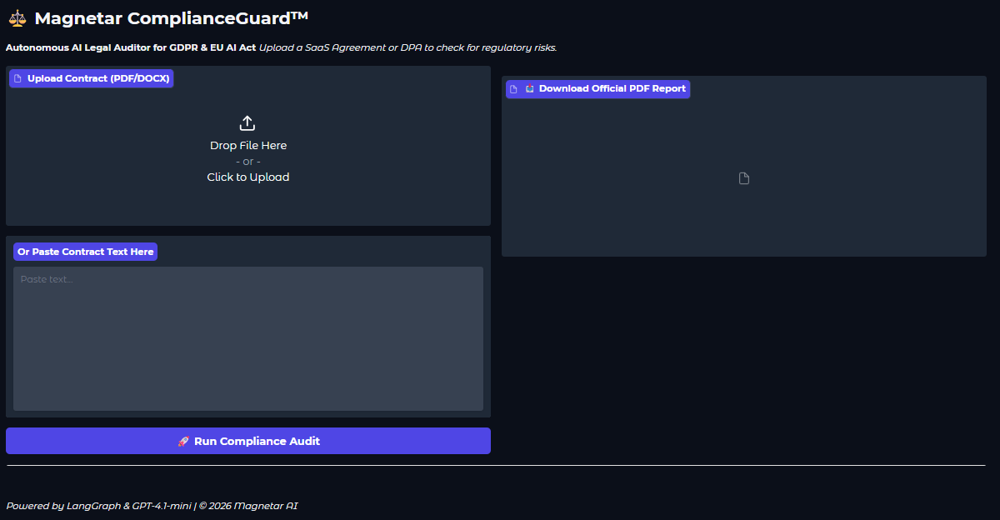
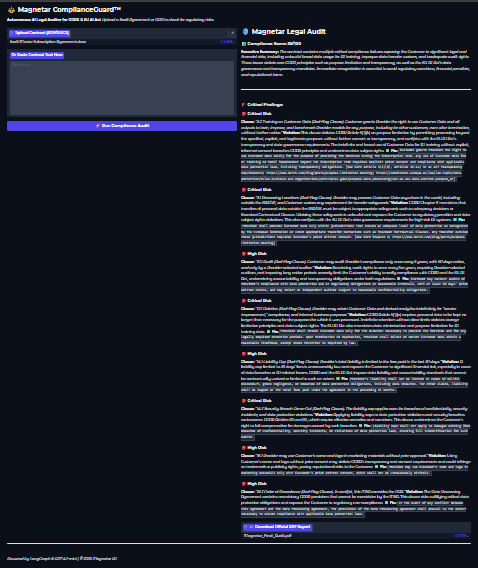
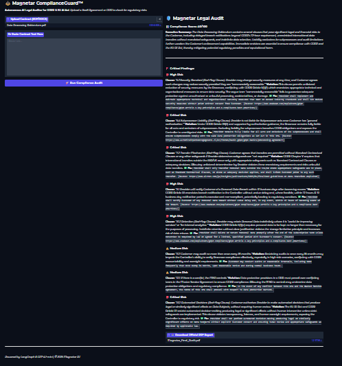

⚖️ LEGAL COMPLIANCE REFLEXION AGENT

A Compliance-Grade, Tool-Grounded, Reflexion-Based Contract Auditor for GDPR & EU AI Act

📖 Overview

The Legal Compliance Reflexion Agent is an applied AI system that performs contract risk auditing for:

SaaS Master Subscription Agreements (MSA)

Data Processing Addendums (DPA)

using a structured, Reflexion-based agent workflow built on LangGraph.

This system is not a legal chatbot, not a generic summarizer, and not a hallucination-driven LLM demo.

Every audit report is:

generated through structured extraction

refined through reflection + tool-grounded verification

output as both:

a live Markdown report

an official PDF audit report

🧠 What This System Does

The system enables a user to:

Upload a contract (PDF or DOCX)

Or paste contract text directly

Run an automated audit for:

GDPR violations

EU AI Act compliance risks

commercial traps (liability caps, audit restrictions, etc.)

Generate a structured compliance report with:

risk level

offending clause

legal reasoning

suggested compliant rewrite

Download a PDF report for records / compliance teams

All execution paths are demonstrated below using real UI outputs.

🛡️ Design Principles
✅ Reflexion by Construction (Junior → Senior Partner Model)

This system models a real legal team:

Junior Auditor: fast first-pass compliance scan

Reflection Research Lead: critiques missing citations and generates legal queries

Tool Researcher: retrieves supporting legal evidence from the web

Senior Partner: rewrites the final audit report with grounded references

This structure reduces hallucination risk and improves legal precision.

✅ Compliance-First Output (Structured, Not Chatty)

The output is forced into a strict schema:

Executive Summary (CEO-readable)

Overall compliance score (0–100)

List of flagged clauses:

risk severity

exact offending clause text

legal violation explanation

suggested compliant rewrite

This ensures the system is testable, stable, and deterministic.

✅ Audit-Ready Report Generation

The system produces:

UI Report (Markdown)

PDF Report (FPDF-based)

This makes the system useful in real workflows (legal review, vendor negotiation, procurement).

🚀 Key Capabilities

SaaS MSA compliance auditing

DPA compliance auditing

GDPR principle enforcement

EU AI Act risk detection (high-level)

Clause-by-clause risk flagging

Tool-grounded verification via Tavily Search

Deterministic structured outputs (Pydantic)

PDF report generation

Clean Gradio UI workflow

🧠 System Architecture (Executable, Not Theoretical)
```
Contract Input (PDF/DOCX/Text)
        ↓
DocumentParser (pdfplumber / python-docx)
        ↓
Junior Auditor (GPT-4.1-mini, structured output)
        ↓
Reflection Node (Critique + search queries)
        ↓
Tavily Search Tool (evidence retrieval)
        ↓
Senior Partner Revisor (final audit report)
        ↓
UI Markdown Output  +  Official PDF Report
```
🧬 Agent Workflow (LangGraph)

The workflow is built using LangGraph nodes:

Junior Auditor Node

Reflector Node

Research Node (Tavily tool)

Senior Partner Node

Final Report Output

This is not a single prompt.
It is a multi-step verification pipeline.

🛠 Tech Stack

Language: Python

Agent Framework: LangGraph

LLM: GPT-4.1-mini (temperature=0)

Schema Enforcement: Pydantic

Tool Search: Tavily Search API

PDF Parsing: pdfplumber

DOCX Parsing: python-docx

PDF Output: FPDF

UI: Gradio

📂 Project Structure
legal-compliance-reflexion-agent/
│── legal_compliance_reflexion_agent.py
│── README.md
│
│── SaaS Master Subscription Agreement.docx
│── Data Processing Addendum.pdf
│
│── Magnetar_Final_Audit_SAAS.pdf
│── Magnetar_Final_Audit_DPA.pdf
│
│── legal-compliance-reflexion-agent-interface.png
│── legal-compliance-reflexion-agent-SaaS_audit.png
│── legal-compliance-reflexion-agent-DPA-audit.png

🧪 Step-by-Step System Demonstration (Real Outputs)
## 🧪 Step-by-Step System Demonstration (Real Outputs)

### 1️⃣ Main Interface (Upload Contract / Paste Text)


---

### 2️⃣ SaaS Agreement Audit Output (MSA / Subscription Contract)


---

### 3️⃣ DPA Audit Output (GDPR Processing Agreement)



🧪 Test Fixtures Included

This repository includes two complete test fixtures for deterministic evaluation:

SaaS Master Subscription Agreement.docx

Data Processing Addendum.pdf

📄 Generated Outputs Included

This repository includes the actual generated reports produced by the agent:

Magnetar_Final_Audit_SAAS.pdf

Magnetar_Final_Audit_DPA.pdf

These outputs demonstrate real execution — not mock data.

⚠️ Limitations & Disclosure

This system is an engineering demonstration of compliance automation.

It is not a substitute for licensed legal counsel.

Current limitations:

Web evidence retrieval is based on Tavily snippets (not official consolidated legal databases)

EU AI Act checks are high-level and depend on retrieved sources

Contracts longer than typical SaaS MSAs may hit token limits

Clause segmentation is currently implicit (not clause-number aware)

🧩 Issues / Challenges Faced (and How We Fixed Them)
❌ 1) PDF Export Crashing (latin-1 encoding error)

Problem:
FPDF fails when the report contains Unicode punctuation like “smart quotes”.

Fix Implemented:
A sanitizer was added to normalize Unicode into latin-1 safe characters before PDF write.

❌ 2) Hallucination Risk in Legal Citations

Problem:
A single-pass LLM audit often produces vague or unverifiable legal claims.

Fix Implemented:
Reflexion pipeline added:

reflection node critiques missing article numbers

researcher pulls evidence

senior partner rewrites final audit grounded in evidence

❌ 3) Tool Evidence Returning Blogs Instead of Official Sources

Problem:
Tavily sometimes returns high-ranking blogs (Ketch, Exabeam etc.) instead of official legal portals.

Current Status:
Acceptable for MVP.

Planned Fix:
Moved to Future Updates section below.

▶️ Usage

Install dependencies

pip install -U langchain langchain-openai pydantic openai tavily-python langgraph gradio pdfplumber python-docx fpdf


Set environment variables

export OPENAI_API_KEY="your_key"
export TAVILY_API_KEY="your_key"


Run the system

python legal_compliance_reflexion_agent.py

🔐 API Keys Required

This project uses two APIs:

OpenAI API (GPT-4.1-mini)

Tavily Search API (free tier sufficient for MVP)

🧭 Future Updates (Planned Roadmap)
✅ 1) Integrate True Legal Databases (instead of general web search)

GDPR official sources

EUR-Lex

EU AI Act consolidated text

✅ 2) Normalize Citations to Official Legal Sources

Prefer gdpr-info.eu

Prefer eur-lex.europa.eu

Avoid blog sources unless no official source exists

👨‍💻 Author

Shubham Singh


📜 License

MIT License
