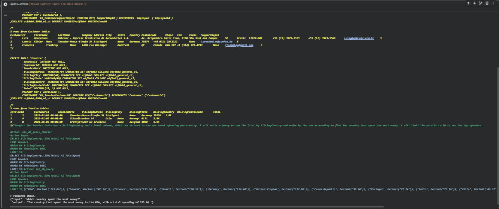
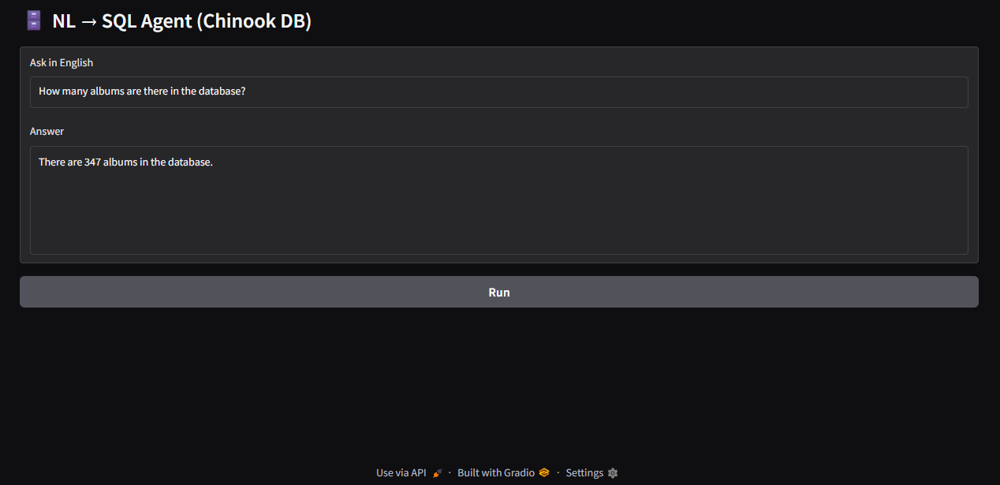
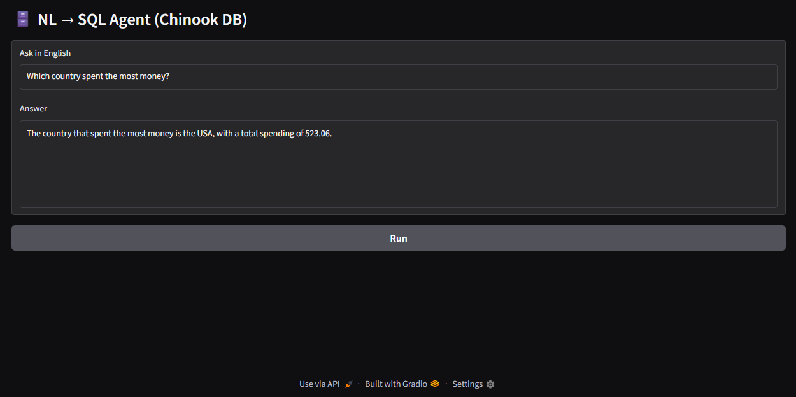
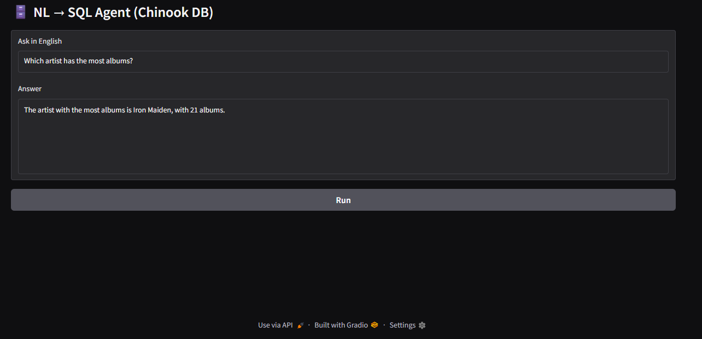
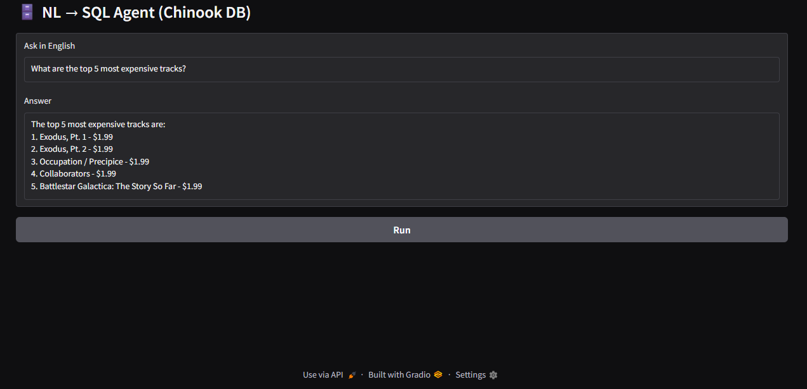
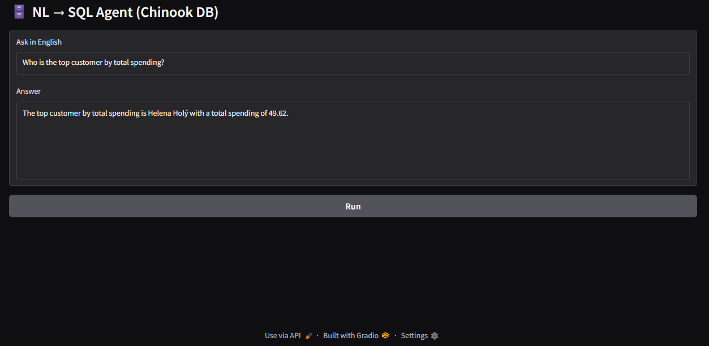

# NL → SQL Agent (Chinook MySQL)

**A LangChain SQL-agent demonstration that converts a natural-language question into a database query and returns the executed result from the Chinook sample database.**

[](https://www.python.org/) [](https://www.mysql.com/) [](https://www.langchain.com/) [](https://www.gradio.app/) [](../LICENSE)

> **Database safety notice:** The checked-in script configures a local MySQL connection using `root:root`, contains a placeholder OpenAI key assignment, and does not enforce read-only SQL permissions in the application code. Do not expose it to an untrusted network or connect it to a production database without hardening the database user, secret handling, query permissions, and access controls.

## Overview

Users enter a question in English. LangChain's SQL agent can inspect the configured MySQL schema, generate a query, execute it, and return the result through Gradio. The demonstrated dataset is Chinook, a sample music-store database with album, artist, track, and customer data. This is SQL-grounded querying, not vector RAG.

## Architecture

```text
Natural-language question
  -> Gradio callback
  -> LangChain SQL agent (gpt-4.1-mini, temperature=0)
  -> MySQL schema inspection / SQL generation
  -> SQL execution against Chinook
  -> returned answer
```

## Demonstrations

### Backend trace



### Album count



### Country spending



### Artist with the most albums



### Most expensive tracks



### Top customer by spending



## Execution environment and setup

The checked-in `.py` file is exported from Google Colab and contains notebook shell commands (`!apt-get`, `!mysql`, `!pip`, `!wget`) as well as a local MySQL server setup sequence. It is **not** directly executable unchanged by running `python nl2sql_agent_mysql.py` in an ordinary terminal.

The original notebook installs MySQL, creates a `Chinook` database, imports the public Chinook MySQL dump, and installs these Python dependencies:

```bash
pip install langchain langchain-community langchain-openai mysql-connector-python gradio
```

Before running the notebook:

1. Replace the placeholder `OPENAI_API_KEY` assignment with a secret/environment-variable setup. Never commit a real key.
2. Use an isolated local/demo MySQL instance and a dedicated least-privilege database user.
3. Confirm the Chinook schema is loaded and the connection URI matches the environment.
4. Run the notebook cells in order, then launch the Gradio interface.

## Query safety limitations

- The current `create_sql_agent` setup is not wrapped by an application-level SQL allow-list or read-only validator. Database permissions are the only reliable boundary unless the code is hardened.
- Never use an administrative `root` account for a language-model-generated SQL workflow.
- The notebook sets the root password to a simple demo value and should only be used in a disposable environment.
- The source calls `demo.launch(share=True)`, which can expose the interface publicly. Do not share it while it can reach an untrusted or sensitive database.
- SQL execution is grounded in database results, but an incorrect query can still return incomplete or misleading results.
- No automated test suite covers injection attempts, permission boundaries, or query correctness in this folder.

## Repository files

```text
nl2sql-agent-mysql/
├── README.md
├── nl2sql_agent_mysql.py
├── sql_agent_incode_testing_backend.png
├── sql_agent_test_1.png
├── sql_agent_test_2.png
├── sql_agent_test_3.png
├── sql_agent_test_4.png
└── sql_agent_test_5.png
```

## Author

**Shubham Kumar Singh**

## License

This project is licensed under the **MIT License**. The complete license text is reproduced below and is also available in the repository's [`LICENSE`](../LICENSE) file.

```text
MIT License

Copyright (c) 2026 Shubham Kumar Singh

Permission is hereby granted, free of charge, to any person obtaining a copy
of this software and associated documentation files (the "Software"), to deal
in the Software without restriction, including without limitation the rights
to use, copy, modify, merge, publish, distribute, sublicense, and/or sell
copies of the Software, and to permit persons to whom the Software is
furnished to do so, subject to the following conditions:

The above copyright notice and this permission notice shall be included in all
copies or substantial portions of the Software.

THE SOFTWARE IS PROVIDED "AS IS", WITHOUT WARRANTY OF ANY KIND, EXPRESS OR
IMPLIED, INCLUDING BUT NOT LIMITED TO THE WARRANTIES OF MERCHANTABILITY,
FITNESS FOR A PARTICULAR PURPOSE AND NONINFRINGEMENT. IN NO EVENT SHALL THE
AUTHORS OR COPYRIGHT HOLDERS BE LIABLE FOR ANY CLAIM, DAMAGES OR OTHER
LIABILITY, WHETHER IN AN ACTION OF CONTRACT, TORT OR OTHERWISE, ARISING FROM,
OUT OF OR IN CONNECTION WITH THE SOFTWARE OR THE USE OR OTHER DEALINGS IN THE
SOFTWARE.
```
