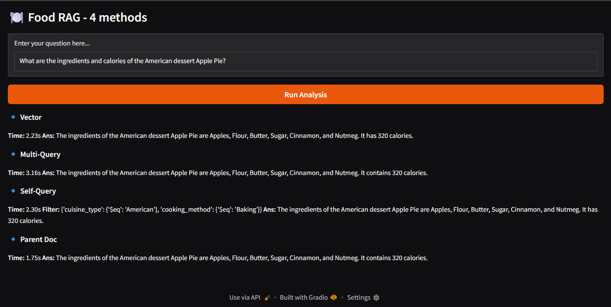
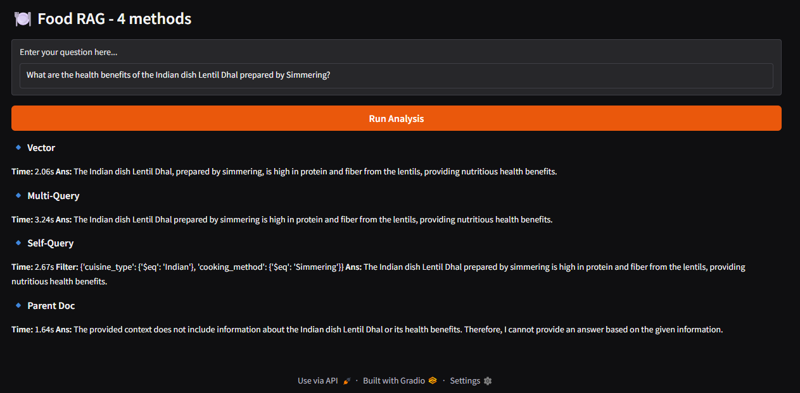
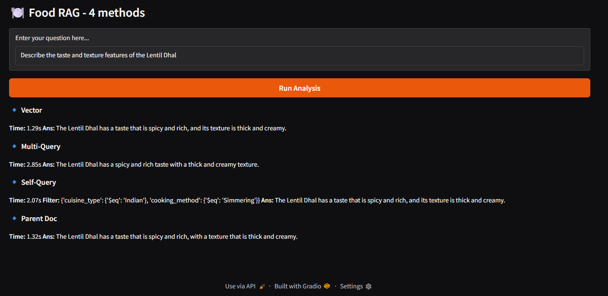
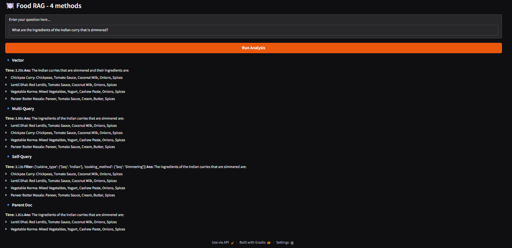
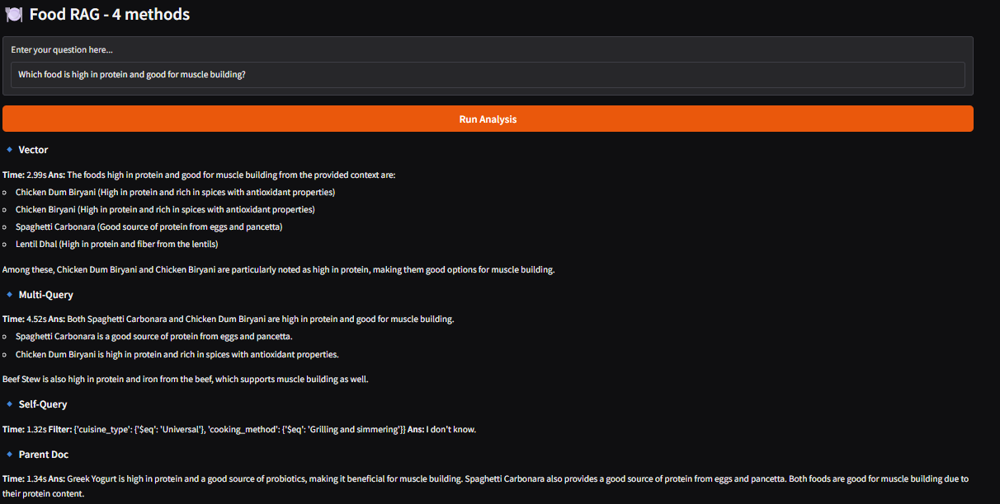

# 🧪 RETRIEVAL METHODS BENCHMARK  
**A Deterministic, Comparative Evaluation of Retrieval Strategies in Agentic RAG Systems**

---

## 📖 Overview

The **Retrieval Methods Benchmark** is a **research-grade, execution-backed evaluation system** designed to compare and stress-test multiple **retrieval strategies** used in modern Retrieval-Augmented Generation (RAG) pipelines.

This project is **not** a chatbot, **not** a prompt experiment, and **not** a generic RAG demo.

It exists to answer a precise engineering question:

> *How do different retrieval strategies behave under strict grounding, deterministic constraints, and real-world edge cases?*

All answers are generated **only** from a static JSON dataset and are evaluated under **identical conditions**, enabling direct comparison across methods.

---

## 🎯 What This Benchmark Evaluates

This system compares **four distinct retrieval methodologies**, executed side-by-side for the same user query:

1. **Vector Similarity Retrieval**
2. **Multi-Query Expansion Retrieval**
3. **Self-Query (Metadata-Constrained) Retrieval**
4. **Parent Document Reconstruction Retrieval**

Each method is evaluated for:
- correctness
- grounding discipline
- recall vs precision tradeoffs
- latency
- failure behavior under ambiguity

---

## 🧠 Design Philosophy

### ✅ Deterministic by Design
- Single embedding model
- Fixed vector dimension
- No reranking layers
- No probabilistic fallback answers
- Temperature = 0

### ✅ Grounding-First (Hallucination-Averse)
- LLM answers **only** from retrieved context
- Missing data results in **explicit refusal**
- No inferred or estimated nutrition or health claims

### ✅ Method Isolation
- Each retrieval strategy is executed independently
- No cross-contamination of results
- Latency measured per method

---

## 🔍 The Four Retrieval Methods

### 1️⃣ Vector Similarity
- Standard semantic similarity search
- Top-k vector retrieval from Pinecone
- Baseline retrieval strategy

### 2️⃣ Multi-Query Expansion
- LLM generates multiple reformulations of the user query
- Each query retrieves independently
- Context is unioned before answering

### 3️⃣ Self-Query (Strict Metadata Filtering)
- LLM extracts structured filters from the query
- Filters must match **exact database vocabulary**
- Invalid filters are rejected
- Enforces schema discipline

### 4️⃣ Parent Document Retrieval
- Retrieves chunks first
- Reconstructs full parent documents
- Maximizes grounding, minimizes hallucination
- Recall-limited by design

---

## 🧠 System Architecture
```
User Query
↓
SentenceTransformer Embedding
↓
Pinecone Vector Index
↓
┌──────────────────────────────────────────┐
│ Vector | Multi | Self-Query | Parent Doc │
└──────────────────────────────────────────┘
↓
Strict Context Assembly
↓
LLM (Context-Only Answering)

```
---

## 🧬 Embeddings & Vector Store

- **Embedding Model:** BAAI/bge-large-en-v1.5  
- **Embedding Dimension:** 1024 (LOCKED)  
- **Normalization:** Enabled  
- **Vector Database:** Pinecone (Serverless)  
- **Similarity Metric:** Cosine  

The embedding space is **global, stable, and deterministic**.

---

## 🛠 Tech Stack

- **Language:** Python  
- **UI:** Gradio  
- **LLM:** GPT-4.1-mini  
- **Embeddings:** SentenceTransformers  
- **Vector DB:** Pinecone  
- **Text Splitting:** RecursiveCharacterTextSplitter  
- **Data Source:** Static JSON (`FoodDataSet.json`)  

---

## 📂 Project Structure
```
retrieval-methods-benchmark/
│── food_rag_methodologies.py
│── FoodDataSet.json
│── output_test_1.png
│── output_test_2.png
│── output_test_3.png
│── output_test_4.png
│── output_test_5.png
│── README.md
```

---

## 🧪 Benchmark Execution & Results

All screenshots below are **real executions** of the system UI, captured without modification.

---

### 🟢 Test 1: Sanity Check (Calories Retrieval)

**Query:**  
> *What are the ingredients and calories of the American dessert Apple Pie?*

**Purpose:**  
Validate chunking, field preservation, and basic retrieval correctness.



---

### 🟡 Test 2: Strict Metadata Filter Validation

**Query:**  
> *What are the health benefits of the Indian dish Lentil Dhal prepared by Simmering?*

**Purpose:**  
Validate exact vocabulary matching and strict filter enforcement.



---

### 🔴 Test 3: Hidden JSON Feature Extraction

**Query:**  
> *Describe the taste and texture features of the Lentil Dhal.*

**Purpose:**  
Ensure nested JSON (`food_features`) survives chunking and parent reconstruction.



---

### ⚡ Test 4: Tense Normalization Trap

**Query:**  
> *What are the ingredients of the Indian curry that is simmered?*

**Purpose:**  
Verify tense normalization (`simmered → Simmering`) without schema violation.



---

### 🧊 Test 5: Null Filter Fallback Behavior

**Query:**  
> *Which food is high in protein and good for muscle building?*

**Purpose:**  
Ensure system does **not** hallucinate filters and fails safely when structure is absent.



---

## ⚠️ Limitations & Disclosure

- No probabilistic reasoning
- No automatic ranking across methods
- No numeric nutrition inference
- Dataset-bound knowledge only
- Ambiguous queries may correctly return “I don’t know”

This benchmark is intentionally **conservative** and **audit-friendly**.

---

## ▶️ Usage

```bash
pip install numpy sentence-transformers pinecone openai gradio
python food_rag_methodologies.py
```
👨‍💻 Author

Shubham Singh


📜 License

MIT License
