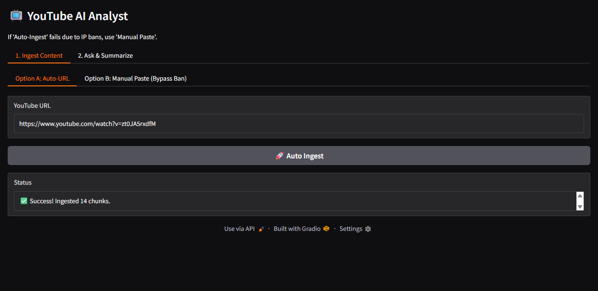
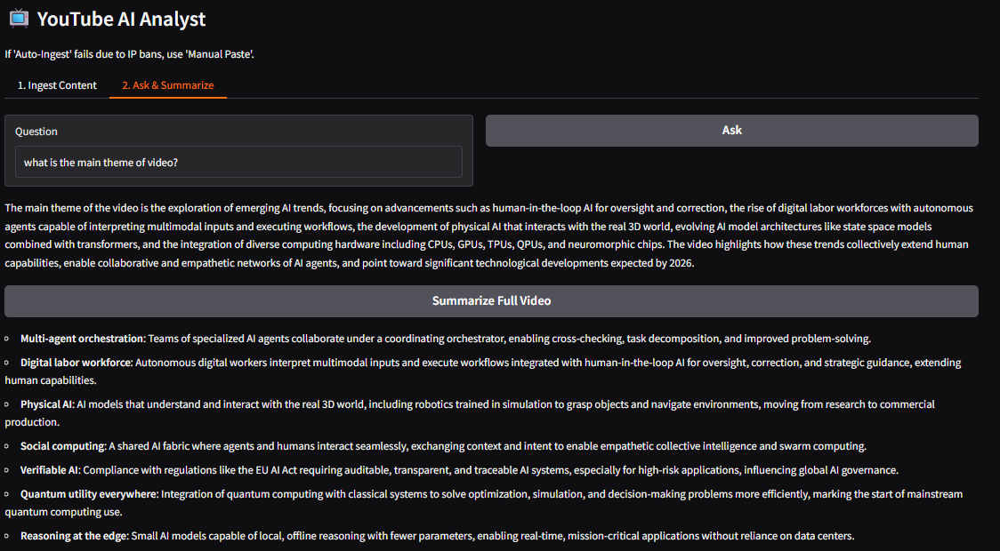
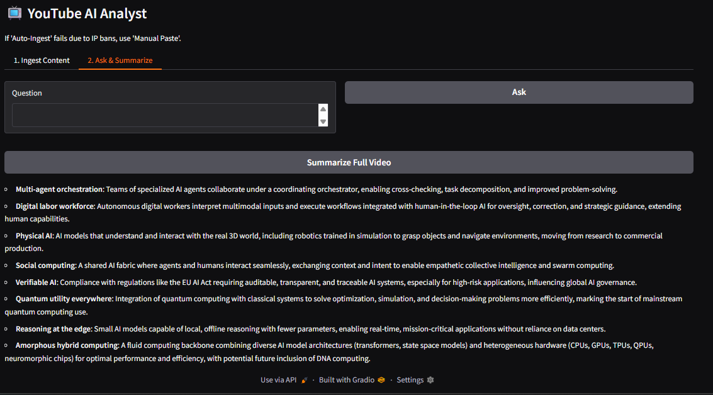
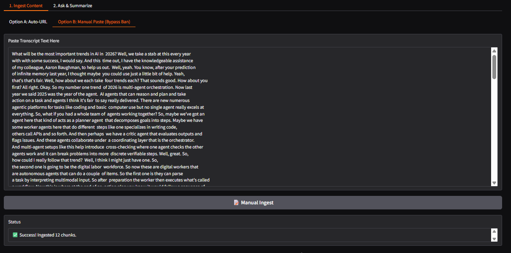
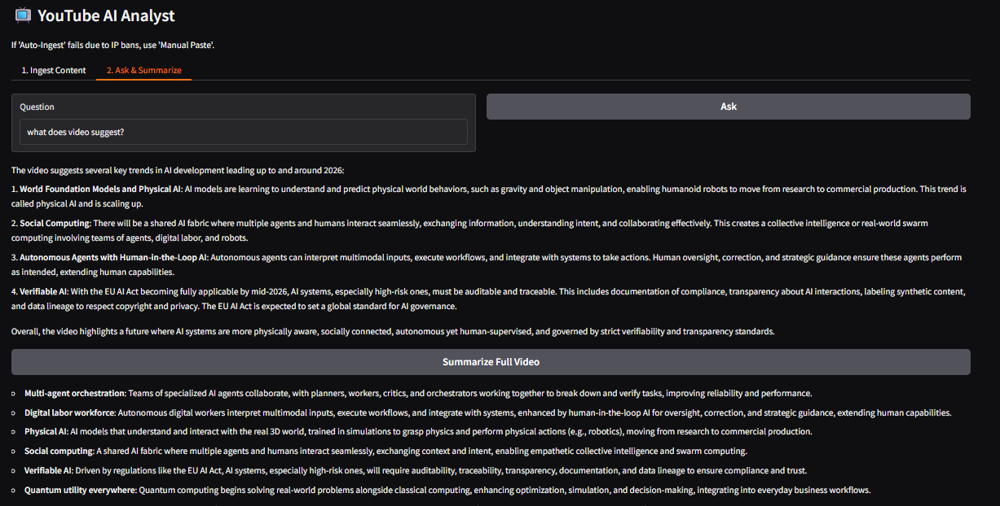
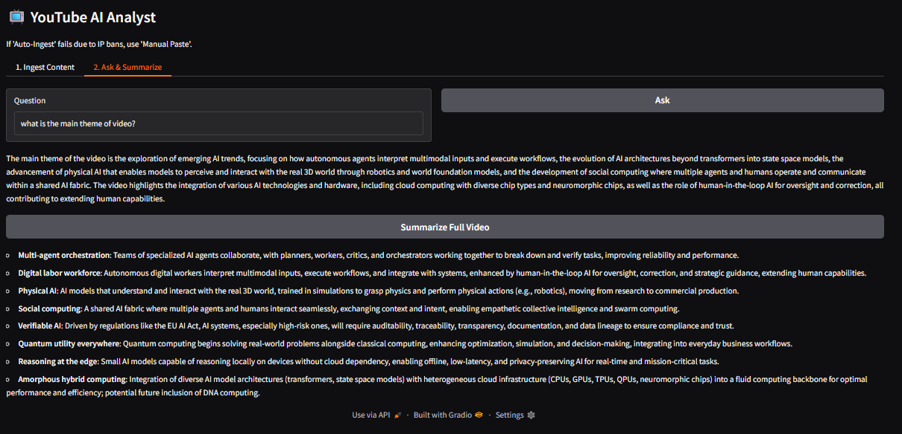

# YouTube RAG Analyst

**A transcript-grounded question-answering and summarization prototype with automatic subtitle ingestion, manual transcript fallback, local FAISS retrieval, and an interactive Gradio interface.**

[](https://www.python.org/) [](https://faiss.ai/) [](https://www.sbert.net/) [](https://www.gradio.app/) [](../LICENSE)

## Overview

The application can attempt to obtain English subtitles from a YouTube URL using `yt-dlp`, or accept a transcript pasted by the user. It chunks the transcript, builds an in-memory FAISS index using `sentence-transformers/all-MiniLM-L6-v2`, and retrieves the top four chunks for a question. A LangChain chat model drafts an answer from the retrieved context. The app also has a summary action that sends up to the first 15,000 characters of the transcript directly to the model.

The manual input path avoids dependence on automatic subtitle retrieval, but it does not make the automatic path immune to YouTube changes or rate limits.

## Workflow

```text
YouTube URL -> yt-dlp subtitle extraction ──┐
                                            ├-> transcript -> chunks (1,000 / overlap 150)
Manual transcript paste ────────────────────┘        -> MiniLM embeddings -> in-memory FAISS
                                                          ├-> top-4 retrieval -> Q&A
                                                          └-> first 15,000 chars -> summary
```

## Configuration

| Setting | Value in source |
|---|---|
| Embedding model | `sentence-transformers/all-MiniLM-L6-v2` |
| Embedding dimension | `384` (model dimension) |
| Vector store | FAISS in memory |
| Chunk size / overlap | `1000` / `150` characters |
| Q&A retrieval | `k=4` |
| LLM | `gpt-4.1-mini` |
| Temperature | `0.2` |
| Automatic subtitles | English subtitles/captions sought via `yt-dlp` |
| Manual input minimum | 50 characters |

## Demonstrations

### Automatic ingestion via URL



### Q&A after automatic ingestion



### Transcript summary



### Manual transcript ingestion



### Follow-up question on manual input



### Recorded equivalent-output example



The last screenshot documents a sample run; it is not a formal proof that the two ingestion paths always generate identical answers.

## Run locally

Unlike several other folders in this repository, the checked-in `yt_rag.py` does not include Colab-only imports or notebook magic. It can be run as a regular Python script after installing its dependencies and setting an API key.

1. Create and activate a virtual environment.
2. Install dependencies:

   ```bash
   pip install yt-dlp requests gradio langchain-community langchain-openai langchain-text-splitters faiss-cpu sentence-transformers
   ```

3. Set `OPENAI_API_KEY` in the shell environment. For example, PowerShell:

   ```powershell
   $env:OPENAI_API_KEY = "your-api-key"
   ```

4. Start the application:

   ```bash
   python yt_rag.py
   ```

5. In the UI, ingest a transcript first, then ask a question or request a summary.

## Limitations and privacy

- Automatic subtitle access may fail because a video lacks English captions, YouTube changes, network issues, or rate limits.
- Q&A uses retrieved transcript chunks, but model output can still misstate content. Review answers against the transcript.
- Summarization does not use retrieved chunks; it sends only the first 15,000 characters of the stored transcript to the model, so later content may be omitted.
- `temperature=0.2` means outputs are not strictly deterministic.
- Transcript/index state is stored in a module-level dictionary in a single process. Multiple concurrent users can interfere with each other's state; this is not a multi-tenant service.
- Transcript text is sent to the configured OpenAI endpoint. Ensure you have permission to process the content and avoid confidential transcripts.

## Repository files

```text
youtube_rag_analyst/
├── README.md
├── yt_rag.py
├── auto_ingestion_question_answer.png
├── autoingested_summary.png
├── autoingestedvia_Youtube_link.png
├── manual_ingestion.png
├── manual_ingestion_extra_question.png
└── manual_ingestion_same_output.png
```

## Author

**Shubham Kumar Singh**

## License

This project is licensed under the **MIT License**. The complete license text is reproduced below and is also available in the repository's [`LICENSE`](../LICENSE) file.

```text
MIT License

Copyright (c) 2026 Shubham Kumar Singh

Permission is hereby granted, free of charge, to any person obtaining a copy
of this software and associated documentation files (the "Software"), to deal
in the Software without restriction, including without limitation the rights
to use, copy, modify, merge, publish, distribute, sublicense, and/or sell
copies of the Software, and to permit persons to whom the Software is
furnished to do so, subject to the following conditions:

The above copyright notice and this permission notice shall be included in all
copies or substantial portions of the Software.

THE SOFTWARE IS PROVIDED "AS IS", WITHOUT WARRANTY OF ANY KIND, EXPRESS OR
IMPLIED, INCLUDING BUT NOT LIMITED TO THE WARRANTIES OF MERCHANTABILITY,
FITNESS FOR A PARTICULAR PURPOSE AND NONINFRINGEMENT. IN NO EVENT SHALL THE
AUTHORS OR COPYRIGHT HOLDERS BE LIABLE FOR ANY CLAIM, DAMAGES OR OTHER
LIABILITY, WHETHER IN AN ACTION OF CONTRACT, TORT OR OTHERWISE, ARISING FROM,
OUT OF OR IN CONNECTION WITH THE SOFTWARE OR THE USE OR OTHER DEALINGS IN THE
SOFTWARE.
```
